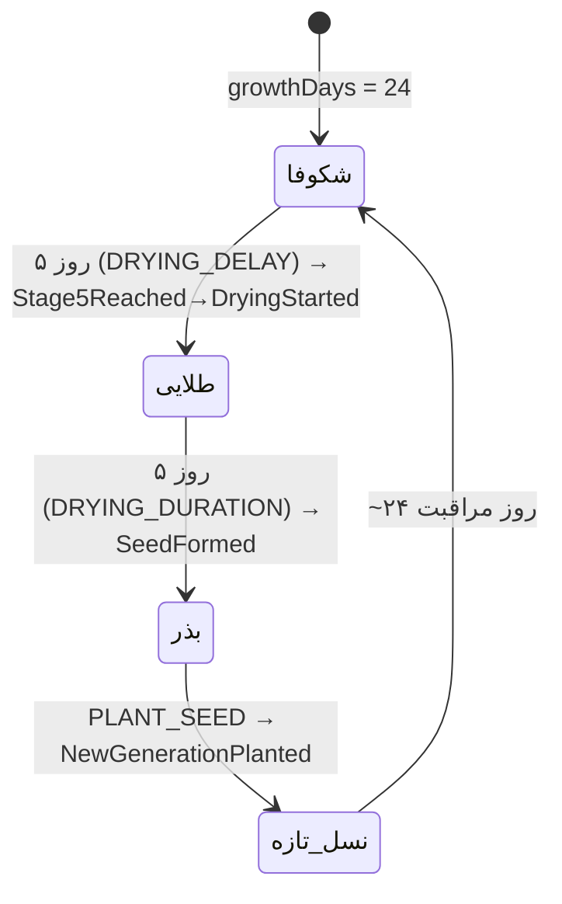

# جوانه 🌿 — سند جامع مهندسی معکوس و بازنویسی صفر تا صد

**عنوان کامل:** تحلیل علمی کد، الگوریتم‌ها، فلسفه‌ی طراحی، مطالعه‌ی بازار و راهنمای کامل بازسازی از صفر
**نسخه‌ی سند:** 1.0 — اکتبر ۲۰۲۶
**دامنه:** هر دو نسل برنامه — نسل ۱ (نسخه‌ی ۶ «باغچه‌ی کلاس»، تک‌سروری آفلاین) و نسل ۲ (مونوریپو SPEC v3.0)
**مخاطب:** توسعه‌دهنده‌ای که می‌خواهد کد را عمیق بفهمد، به چرایی تصمیم‌ها پی ببرد و بتواند کل محصول را از صفر بازسازی کند

> این سند از **مطالعه‌ی مستقیم کدهای واقعی** نوشته شده است:
> `app/engine.js` (موتور دامنه v5.0)، `app/server.js` (سرور v6.0.0)، فایل‌های `app/public/js/*` (رابط کاربری)،
> `JAVANEH-V6-VISION.md` (سند چشم‌انداز v6)، `JAVANEH-ZAI-SPEC.md` (سند پیاده‌سازی v3.0)
> و `packages/domain/src/*` (نسل دوم). هر ادعا با ارجاع به فایل قابل راستی‌آزمایی است.

---

## فهرست مطالب

- بخش ۰ — راهنمای مطالعه‌ی این سند
- بخش ۱ — فلسفه‌ی محصول (چرایی)
- بخش ۲ — مطالعه‌ی بازار و جایگاه رقابتی
- بخش ۳ — معماری دو نسل
- بخش ۴ — مدل داده و دیکشنری کامل
- بخش ۵ — الگوریتم‌ها (تحلیل عمیق)
- بخش ۶ — لایه‌ی تجربه‌ی کاربری
- بخش ۷ — نسل دوم: مونوریپو (SPEC v3.0)
- بخش ۸ — مدل تهدید، امنیت و «هک» مطالعاتی
- بخش ۹ — راهنمای بازنویسی صفر تا صد (Playbook)
- بخش ۱۰ — دفتر تصمیم‌ها (ADR)
- بخش ۱۱ — پرسش‌های متداول طراحی
- بخش ۱۲ — نقشه‌ی راه آینده
- پیوست‌ها (گلسری، درخت فایل، فهرست تست‌ها، چک‌لیست اصول)

---

## بخش ۰ — راهنمای مطالعه‌ی این سند

### ۰.۱ این سند برای چه کسی نوشته شده؟

سه نوع خواننده در نظر گرفته شده است و برای هر کدام مسیر مطالعه‌ی متفاوتی پیشنهاد می‌شود:

| خواننده | مسیر پیشنهادی | خروجی مورد انتظار |
|---|---|---|
| **مدیر محصول / کارآفرین** | بخش ۱ → ۲ → ۱۲ → ۱۰ | می‌فهمد این محصول چرا متفاوت است و کجا می‌رود |
| **مهندس بازنویسی‌کننده** | بخش ۳ → ۴ → ۵ → ۹ → پیوست‌ها | می‌تواند بدون پرسیدن سؤال، کل سیستم را از صفر بسازد |
| **پژوهشگر / منتقد** | بخش ۱ → ۵ → ۸ → ۱۱ | می‌تواند نقاط ضعف تصمیم‌ها را علمی نقد کند |

### ۰.۲ قواعد نگارش

- اصطلاحات فنی به انگلیسی و متن توضیحی به فارسی است (همان قاعده‌ی خود پروژه).
- هر جا از کد نقل‌قول شده، مسیر فایل و شماره‌ی منطق ذکر شده تا بتوانید خودتان راستی‌آزمایی کنید.
- نمودارها به دو زبان‌اند: **Mermaid** (برای نمایش در GitHub/VS Code) و **ASCII** (برای هر ویرایشگر متنی).
- اعداد ثابت برنامه دقیقاً همان مقادیر کد هستند؛ هیچ عددی «تزئینی» نیست.

### ۰.۳ سه جمله‌ای که کل محصول را خلاصه می‌کند

1. «هرچه کودک بیشتر مراقبت کند، گیاهش نه **قوی‌تر**، بلکه **خاص‌تر و پرخاطره‌تر** می‌شود.» (سند v6، بخش ۳)
2. «منبع حقیقتِ احساس، **مدت غیبت واقعی** است — نه امتیاز، نه نمره، نه قضاوت.»
3. «این باغچه **مراقبت** است، نه رتبه‌بندی.» (پانوشت پنل معلم، `teacher.template.html` خط ۶۱)

---

## بخش ۱ — فلسفه‌ی محصول (چرایی)

### ۱.۱ مسئله‌ی اولیه: چرا اصلاً «جوانه» ساخته شد؟

طبق سند SPEC v3.0 (بخش ۱)، جوانه برای حل یک مسئله‌ی مشخص ساخته شد:
**«کمک به ایجاد نظم و عادات مثبت در منزل دانش‌آموز در دوران تدریس مجازی»** با کاربر اصلیِ **کودک ۸ تا ۱۲ ساله**.

مسئله‌ی واقعی این بود: در آموزش از راه دور، بزرگ‌ترین حلقه‌ی گم‌شده **پیوند عاطفی میان عادت روزانه و نتیجه‌ی قابل لمس** است. ابزارهای موجود یا «چک‌لیست خشک»اند (تقویم، یادآور) یا «قمار روانی» (استریک، لیدربورد، پاداش تصادفی). جوانه مسیر سومی را انتخاب کرد: **یک موجود زنده‌ی مجازی که فقط به خودِ کودک وابسته است** — رابطه‌ی عاطفی به‌جای سیستم پاداش.

چرا گیاه و نه حیوان (مثل تاماگوچی)؟ چهار دلیل طراحی:

1. **سرعت رشدِ صادقانه:** گیاه آهسته رشد می‌کند؛ این با ریتم واقعی عادت‌سازی (هفته‌ها، نه ساعت‌ها) هم‌خوان است.
2. **غیبتِ بدون مرگ:** گلدانِ بی‌مراقبت پژمرده می‌شود ولی نمی‌میرد — پیامد غیبت **قابل مشاهده ولی غیرتنبیهی** است.
3. **مراقبت به‌جای عملکرد:** گیاه «مهارت» نمی‌خواهد؛ فقط «حضور» می‌خواهد. این برای کودک ۸ ساله‌ای که در ریاضی ضعیف است عادلانه است.
4. **چرخه‌ی نسل و خاطره:** گیاه بعد از شکوفایی بذر می‌دهد؛ پایان داستان نیست، **تداوم** است — مفهومی که هیچ پت دیجیتالی ندارد.

### ۱.۲ اصل بنیادی: «احساس به‌جای عدد» و روان‌شناسیِ پشت آن

هسته‌ی فلسفی جوانه حذف کامل **امتیاز، جان، رتبه، میانگین و لیدربورد** است (SPEC §2 اصل ۱؛ سند v6 بخش ۳). چرایی علمی این تصمیم:

- **انگیزش بیرونی، انگیزش درونی را می‌بلعد.** وقتی «انجام تکلیف» به «+۱۰ امتیاز» تبدیل می‌شود، ذهن کودک هدف را از «مراقبت از موجودم» به «جمع‌کردن عدد» جابه‌جا می‌کند؛ روزی که امتیاز نباشد، انگیزه هم نیست. جوانه به‌جای پاداش بیرونی، **رابطه** می‌سازد که انگیزش درونی می‌آفریند.
- **مقایسه، امنیت روانی کودک ۸–۱۲ ساله را می‌شکند.** لیدربورد یعنی هر روز به پایین‌رفته‌ها «تو بد» گفته شود. در جوانه چیزی به اسم «نفر اول» وجود ندارد؛ کلاس یک **باغچه‌ی جمعی** است، نه جدول مسابقه.
- **جان و امتیاز، دوگانه‌ی برنده/بازنده می‌سازند.** در جوانه بدترین حالتِ حالت‌ها «بی‌تاب» (alert) است که حتی آن هم با «همیشه راهِ برگشت» تعریف شده — آنلاک‌های به‌دست‌آمده **دائمی‌اند** (`engine.js` تصمیم مستند بخش آنلاک‌ها) تا هیچ‌وقت «همه‌چیز را باختم» به وجود نیاید.

نتیجه‌ی عملی در کد: هیچ فیلد امتیازی در `PlantState` وجود ندارد. تنها متغیر کمّیِ محرکِ احساس، **`lastMeaningfulInteractionAt`** است — یعنی «آخرین باری که مراقبت معنادار شد».

### ۱.۳ چهار حالت عاطفی و منطق آستانه‌های آن‌ها

گیاه چهار حالت دارد: **شاداب (thriving) → آرام (content) → دلتنگ (longing) → بی‌تاب (alert)**.

| گذر زمان از آخرین مراقبت معنادار | حالت | برچسب فارسی | منطق انتخاب آستانه |
|---|---|---|---|
| کمتر از ۲۴ ساعت | thriving | شاداب | امروز حضور داشته |
| ۲۴ تا ۴۸ ساعت | content | آرام | یک روزِ کامل طبیعی است — بی‌قضاوت |
| ۴۸ تا ۹۶ ساعت | longing | دلتنگ | دو روز غیبت = یک تعطیلات آخر هفته؛ طبیعی اما قابل توجه |
| بیش از ۹۶ ساعت | alert | بی‌تاب | چهار روز = احتمال «اتفاق افتادن»؛ زمان مداخله‌ی مهربانانه |

چرایی: آستانه‌ها با **ریتم واقعی مدرسه** تنظیم شده‌اند، نه با اعداد دلخواه. آستانه‌ی ۲۴ ساعت باعث نمی‌شود یک عصر معمولی «حالت بد» بسازد؛ آستانه‌ی ۹۶ ساعت یعنی فقط غیبت‌های واقعاً طولانی به سطح «نیازمند توجه معلم» می‌رسند. هیچ‌وقت رنگ قرمز خالص هشداردهنده وجود ندارد (سند v6 §۱۰: «هیچ رنگ قرمز خالص هشداردهنده»).

نکته‌ی مهم معماری: `deriveMood` یک **تابع خالص** است و هر بار از روی state محاسبه می‌شود؛ حالت عاطفی **ذخیره نمی‌شود** چون با گذر زمان بدون هیچ فرمانی عوض می‌شود — «زمان، چهارمین بُعد داده است».

### ۱.۴ پنج اصل تغییرناپذیر (سند v6 §۳ + §۱۲)

این پنج اصل در هر دو نسل، مرزِ لغزنده نیستند؛ قانون اساسی‌اند:

1. **هیچ رتبه‌بندی، میانگین، لیدربورد یا مقایسه‌ای وجود ندارد.** حتی در پنل معلم.
2. **منبع حقیقتِ احساس، مدت واقعی غیبت است.** نه باز کردن اپ، نه کلیک بی‌هدف.
3. **معلم «مراقب» است، نه «کنترل‌کننده».** پنل معلم ابزار گفت‌وگو می‌دهد، نه ابزار نظارت.
4. **گیاه هر کودک باید خاص‌تر و پرخاطره‌تر شود، نه فقط قوی‌تر.** پیشرفت = خاطره و شخصیت، نه عدد بزرگ‌تر.
5. **حریم عاطفی کودک خط قرمز است.** نام کودک در باغچه برجسته نمی‌شود (فقط نام گیاه)؛ وضعیت فردی در حالت تخته‌ای نمایش داده نمی‌شود؛ در نسل دوم (SPEC §۱۴) حتی «رادار فردی معلم» صریحاً ممنوع است — معلم فقط جمع کلی می‌بیند.

### ۱.۵ فلسفه‌ی سمت معلم: «سیستم مراقبت سه‌لایه»

سند v6 هدف را این‌طور تعریف می‌کند: *«معلم وقتی جوانه را باز می‌کند، احساس کند حال واقعی کلاسش را می‌بیند و بهانه‌ی مهربانانه‌ای برای گفت‌وگو دارد — نه اینکه یک داشبورد مدیریتی دیگر ببیند.»*

سه لایه با زمان‌بندی روانی طراحی شده‌اند:

| لایه | زمان هدف | ابزار | چرا |
|---|---|---|---|
| **رادار کلاس** | ۱۰ ثانیه | یک جمله‌ی انسانی + خبرهای خوب + حداکثر ۵ نام «نیازمند توجه» | تشخیص سریع، بدون شیرجه در داده |
| **باغچه‌ی زنده** | ۱ دقیقه | گلدان‌ها با نام گیاه، رنگ و فرمِ حالت | دیدن «کل» به‌صورت یک موجود زنده، نه جدول |
| **کارت گفت‌وگو (Drawer)** | ۲–۳ دقیقه | وضعیت به زبان انسانی («۳ روزه ندیده») + پیشنهاد جمله‌ی شروع | تبدیل «دیتا» به «مکالمه» — مهم‌ترین لایه |

و برای اینکه پنل معلم «اختیاری» نماند، سه **آیین کلاسی** در خود برنامه مستند شده‌اند (v6 §۵): **صبحانه‌ی گیاهی** (اول کلاس، ۱–۲ دقیقه، حالت تخته‌ای)، **بازدید خصوصی** (بین زنگ‌ها، از روی رادار)، و **آیین نسل جدید** (وقتی بذر آماده شد). هدف این است که جوانه بخشی از **روتین فرهنگی کلاس** شود، نه یک اپ کنار بقیه.

### ۱.۶ فلسفه‌ی فنی: چرا آفلاینِ مطلق؟

جوانه سه تصمیم فنیِ فلسفی دارد که از نسخه‌ی ۱ تا امروز ثابت مانده‌اند:

1. **آفلاینِ کامل، صفر وابستگی بیرونی:** هیچ CDN، فونت خارجی، تصویر اینترنتی، سرویس یا API وجود ندارد. چرایی: (الف) مدارس ایران اینترنت پایدار ندارند؛ (ب) حریم داده‌ی کودک — هیچ بایتی از کلاس بیرون نمی‌رود؛ (ج) طول عمر — محصولی که به هیچ سرویس بیرونی وابسته نیست، ده سال بعد هم کار می‌کند.
2. **ذخیره‌سازی محلی (`data.json`):** داده در همان پوشه‌ی برنامه است؛ معلم می‌تواند از آن نسخه‌ی پشتیبان بگیرد و بداند «مالکِ داده خودم هستم».
3. **فونت و دارایی سیستمی:** همه‌ی آیکون‌ها emoji، همه‌ی گرافیک SVG درون‌کدی، همه‌ی صداها WebAudio سنتزشده — بسته‌ی توزیع فقط ~۱۲۰ کیلوبایت است.

این فلسفه در نسل دوم هم حفظ شده: PWA با Service Worker آفلاین کامل کار می‌کند و در فاز ۱ **هیچ شبکه‌ای در حلقه‌ی بازی نیست** (SPEC §۱۰: «بدون وابستگی اجباری به سرور»).

---

## بخش ۲ — مطالعه‌ی بازار و جایگاه رقابتی

> **صداقت روش‌شناختی:** این بخش تحلیل **کیفی** بر اساس دسته‌بندی محصولات شناخته‌شده و اسناد داخلی خود پروژه است (به‌خصوص v6-VISION §۸). هیچ عدد بازاری ساختگی (حجم بازار، درصد رشد و…) درج نشده؛ هر جا عدد لازم است، باید پیش از هر تصمیم تجاری با پژوهش میدانی تأیید شود.

### ۲.۱ نقشه‌ی رقبا در چهار دسته

| دسته | نمونه‌ها | منطق طراحی | جای خالی نسبت به جوانه |
|---|---|---|---|
| **پت/گیاه مجازی فردی** | Tamagotchi/Pou، Forest، Finch، Focus Plant، Plantale | رابطه‌ی عاطفی فردی، یا تمرکز/علوم | هیچ‌کدام «پیوند با غیبت واقعی مدرسه» و «پنل مراقبت معلم» ندارند؛ اکثراً تک‌کاربره‌اند |
| **گیمیفیکیشن کلاس** | ClassDojo، Classcraft، LiveSchool، SparkMyClass | امتیاز، گروه، جدول، پاداش بیرونی | تقریباً همه بر رقابت بنا شده‌اند؛ جوانه **آگاهانه** از این مسیر دوری می‌کند |
| **عادت‌سازی عمومی** | Habitica، استریکِ Duolingo | استریک، نردبان، جریمه | استریک شکستن دارد و «شکست» می‌آموزد؛ جوانه به‌جای شکست، «دلتنگی» دارد که قابل جبران است |
| **ابزارهای مدرسه‌ای ایران** | پوشش‌های LMS داخلی، پیام‌رسان‌های آموزشی | مدیریت محتوا و نمره | هیچ‌کدام لایه‌ی عاطفی/عادتی برای خودِ کودک ندارند؛ اکثراً نیازمند اینترنت و سرور مرکزی‌اند |

### ۲.۲ فضای خالی: دسته‌ی تازه‌ای به اسم «همراه مراقبت عاطفی کلاس»

سند v6 (§۸) نتیجه‌گیری دقیقی دارد — محصولی که هم‌زمان پنج ویژگی زیر را داشته باشد، **در هیچ‌کدام از دسته‌های بالا وجود ندارد**:

1. موجود مجازی عاطفی (نه چک‌لیست)؛
2. موتور بر اساس **غیبت واقعی** (نه کلیک)؛
3. پنل معلمِ **مراقبتی** نه کنترلی؛
4. **بدون رقابت**؛
5. هم **مجازی** و هم **حضوری** قابل استفاده (حالت تخته‌ای + آیین‌ها).

پس استراتژی جوانه ساختن یک دسته‌ی جدید است: **Emotional Care Companion for Classrooms**. تهدید اصلی هم همین‌جا ذکر شده: *«افتادن به دام امتیاز و لیدربورد»* — چون فشار بازار به سمت «قابلیت‌های آشنا» است.

### ۲.۳ تحلیل SWOT

| | مثبت | منفی |
|---|---|---|
| **درونی** | **S:** فلسفه‌ی متمایز و قابل دفاع؛ معماری آفلاینِ صفر-وابستگی (هزینه‌ی نگهداشت تقریباً صفر)؛ بسته‌ی ~۱۲۰KB بدون نیاز به نصب پیچیده؛ موتور دامنه‌ی تست‌شده (۲۲+۱۶ تست) | **W:** بدون سرور = بدون احراز هویت (کودک می‌تواند تیک دروغ بزند — بحث کامل در بخش ۸)؛ بدون آمار ابری = بدون گزارش «مدیریتی» برای خریداران سنتی |
| **بیرونی** | **O:** فضای خالیِ دسته‌ی جدید؛ پیام‌رسان بله به‌عنوان کانال معلم (فاز ۲ SPEC)؛ مدارس به دنبال ابزار عادت بدون رقابت‌زایی‌اند؛ PWA = نصب بدون فروشگاه اپ | **T:** رقبا می‌توانند «حالت بدون امتیاز» اضافه کنند؛ مقاومت فرهنگی معلم‌ها به ابزار جدید؛ محدودیت دستگاه‌های ضعیف (که جوانه با سبکی خودش مهار کرده) |

### ۲.۴ چرا «بدون رتبه» هم مزیت است، هم ریسک؟

- **مزیت:** تمایز اخلاقیِ قابل روایت است — والدین و معلم‌های دلسوز از «کلاس مسابقه» خسته‌اند؛ جوانه روایتی روشن دارد. این تمایز در کد هم قابل راستی‌آزمایی است (نه فقط شعار): هیچ endpoint یا فیلدی «بهترین بچه» را نمی‌دهد.
- **ریسک:** بخشی از بازار به «داشبورد و عدد» عادت کرده‌اند؛ در دموی فروش ممکن است بپرسند «خب، کدام بچه اول است؟». پاسخ محصول باید از فلسفه بیاید: *«سؤال درست این است: چه کسی امروز به گفت‌وگو نیاز دارد؟»* — رادار همین را می‌دهد.

### ۲.۵ مدل توزیع و درآمد محتمل (بر پایه‌ی فازهای SPEC)

سند SPEC v3.0 از فاز ۳–۴ معماری تجاری را دارد: `web-school` (پنل مدرسه) و `web-admin` (پنل مالک) با جداول `schools/teachers/classes/students` و مفهوم **seat** و اشتراک (`subscription_start/end`). یعنی مدل تجاری طراحی‌شده **B2B مدرسه‌محور** است: لایسنس مدرسه، سقف کلاس/دانش‌آموز، تعلیق/فعال‌سازی. مزیت هم‌خوان با فلسفه: داده‌ی کودک روی سرور مدرسه/مالک می‌ماند و فقط خلاصه‌ی بی‌نام (فعال امروز/هفته) به معلم می‌رسد.

### ۲.۶ ریسک‌های پذیرش و مهار آن‌ها

| ریسک | سناریو | مهارِ طراحی‌شده در محصول |
|---|---|---|
| تیک دروغ | کودک بدون انجام تکلیف تیک می‌زند | پذیرش آگاهانه: محصول «اعتمادمحور» است؛ در نسل ۲ فقط `hadMeaningfulCare` بولی به سرور می‌رود، نه اثبات — بحث کامل در بخش ۸ |
| فراموشی معلم | پنل معلم باز نمی‌شود | آیین‌ها + رادار ۱۰ ثانیه‌ای + معیار موفقیت v6: «معلم هفته‌ای ۲–۳ بار باغچه را باز کند» |
| فرسودگی اپ | رشد خطی و پیش‌بینی‌پذیر خسته‌کننده می‌شود | رویاها (۱۲+۶ یکتا در نسل)، چرخه‌ی نسل، اتاق و آنلاک‌ها — «خاص‌تر شدن» به‌جای «قوی‌تر شدن» |
| مقیاس کلاس بزرگ | ۳۰+ گلدان شلوغ | فیلتر «فقط نیازمندِ توجه»، رادار سقف ۵، و در SPEC سقف پیش‌فرض ۳۰ نفر/کلاس |

---

## بخش ۳ — معماری دو نسل

### ۳.۱ نسل ۱ — نسخه‌ی ۶ «باغچه‌ی کلاس» (تک‌سروری آفلاین)

```
┌─────────────────────── یک کامپیوتر کلاس ────────────────────────┐
│                                                                  │
│  START-WINDOWS.bat / START-MAC-LINUX.sh                          │
│        │  (نگهبان: اگر پوشه app نبود → پیام «یکجا Extract کنید») │
│        ▼                                                         │
│  node server.js   ← پورت ۳۰۰۰ (اشغال بود → ۳۰۱۰)                 │
│        │                                                         │
│        ├── engine.js      موتور دامنه (تصمیم + اعمال + effects)  │
│        ├── qr.js          ساخت QR آفلاین (SVG)                   │
│        └── data.json      ذخیره‌سازی اتمیک (tmp→rename)           │
│                 │                                                │
│  ┌──────────────┴───────────────────────────────┐                │
│  │ public/index.html   (تک‌فایل: CSS+JS inline) │ ← بچه‌ها        │
│  │ public/teacher.html (تک‌فایل: CSS+JS inline) │ ← معلم          │
│  └───────────────────────────────────────────────┘                │
│                                                                  │
│  موبایل بچه‌ها: همان وای‌فای → http://<LAN-IP>:3000 (از QR)        │
└──────────────────────────────────────────────────────────────────┘
```

سه ویژگی کلیدی این نسل:

- **سرور HTTP خالص Node** (`server.js`، صفر وابستگی — حتی Express هم نیست): فقط `http`, `fs`, `path`, `os`, `child_process`. چرایی: نصب `npm install` لازم نیست، توزیع = کپی پوشه، و زنجیره‌ی شکست به صفر می‌رسد.
- **صفحات تک‌فایلی:** خروجی‌های `index.html`/`teacher.html` همه‌ی CSS و JS را درون خود دارند (ساخت با `tools/inline-build.js`). چرایی: اگر معلم اشتباهاً `index.html` را مستقیم با دابل‌کلیک باز کند، به‌جای صفحه‌ی خامِ شکسته، یک صفحه‌ی راهنمای فارسیِ زیبا می‌بیند (falloff دوستانه).
- **دو آدرس، یک برنامه:** `/` صفحه‌ی دانش‌آموز، `/teacher` پنل معلم — نصب جداگانه وجود ندارد.

### ۳.۲ نسل ۲ — مونوریپو (SPEC v3.0)

```
javaneh/
├── packages/
│   ├── domain/      موتور خالص TypeScript (بدون UI/شبکه/storage)
│   ├── pwa/         اپ کودک: Svelte 5 + Vite + PWA + Dexie
│   ├── api/         (فاز ۲) Fastify + PostgreSQL
│   ├── bale-bot/    (فاز ۲) ربات معلم روی پیام‌رسان بله
│   ├── web-school/  (فاز ۳) پنل مدرسه
│   └── web-admin/   (فاز ۴) پنل مالک
└── docs/SPEC.md     سند حاکم — «اگر در سند نیست، ساخته نشود»
```

| نقش | کانال | فاز |
|---|---|---|
| دانش‌آموز | PWA آفلاین | ۱ (اجرا‌شده) |
| معلم | بله — فقط خلاصه‌ی کلی بی‌نام | ۲ |
| مدرسه | پنل وب | ۳ |
| مالک | پنل وب + seat | ۴ |

قواعد اجباری SPEC §۲ که معماری نسل ۲ را شکل می‌دهند: موتور دامنه خالص؛ مسیر یک‌طرفه‌ی `Command → decide → Event[] → apply`؛ `apply` تصمیم نمی‌گیرد؛ لانچ مرحله‌ای با **feature flag**؛ زمان با `Clock` تزریقی؛ روز با `dayKey` منطقه‌ی `Asia/Tehran`.

### ۳.۳ مقایسه‌ی دو نسل و چراییِ بازنویسی

| محور | نسل ۱ (v6) | نسل ۲ (مونوریپو) | چرا تغییر |
|---|---|---|---|
| زبان/تایپ | JS خالص، تایپ ضمنی | TypeScript سخت‌گیر + exhaustive switch (`never`) | خطا در زمان کامپایل، نه در کلاس |
| زمان | `localDateKey` روی سرور (ساعت محلی رایانه) | `Clock` تزریقی + `dayKey` ثابت `Asia/Tehran` | تست‌پذیری (FakeClock) + یکنواختی روز بین دستگاه‌ها |
| ذخیره | `data.json` سمت سرور | Dexie/IndexedDB سمت کودک (+sync آینده) | آفلاینِ دستگاه‌محور، آماده‌ی چند-دستگاه |
| محرک روز | تسک‌های کلاسی + بیدارباش | ۴ عادت ثابت (wake/brush/homework/sleep) | تمرکز فاز ۱ روی عادت خانگی |
| رویا/نسل/باغچه | کامل فعال | پشت feature flag (فازهای بعد) | لانچ مرحله‌ای، بدون UI مرده |
| معلم | پنل مراقبت کامل (رادار/باغچه) | **فقط خلاصه‌ی عددی بی‌نام** (§۱۴ رادار فردی ممنوع) | سخت‌گیری بیشتر روی حریم کودک |

نکته‌ی ظریف: نسل ۲ «جایگزین فلسفه‌ی نسل ۱» نیست؛ **سخت‌گیرانه‌تر** است. نسل ۱ اثبات کرد که موتور عاطفی کار می‌کند؛ نسل ۲ همان اصول را با ایمنی تایپ، تست خلوص و فازبندی توزیع می‌سازد.

### ۳.۴ الگوی مشترک هر دو نسل: Command → Decide → Event → Apply (+Effects)

```
فرمان (نیَت کودک)      تصمیم (قوانین)        رویداد (حقیقتِ ثبت‌شده)     اعمال (تغییر state)
┌──────────────┐    ┌──────────────┐    ┌──────────────────┐    ┌──────────────┐
│ COMPLETE_HABIT│ →  │    decide     │ →  │ HabitCompleted,   │ →  │  applyEvent  │ → state جدید
│ WAKE_UP …    │    │ (خالص، throw │    │ GrowthTicked, …   │    │ (خالص، تغییر│
└──────────────┘    │  می‌دهد یا   │    └──────────────────┘    │  ناپذیر)     │
                    │  event می‌دهد)│                            └──────────────┘
                    └──────────────┘                                      │
                                                                    ┌─────▼─────┐
                                                                    │  Effects  │ (نسل ۱)
                                                                    │ انیمیشن،  │
                                                                    │ صدا، نمایش│
                                                                    └───────────┘
```

چرا این الگو؟ چهار دلیل مهندسی‌شده (سند معماری v5 §۳–§۴):

1. **جدایی کامل «تصمیم» از «اعمال»:** `decide` فقط رویداد می‌سازد و همه‌ی داده در `payload` قفل می‌شود؛ `applyEvent` **هرگز** به بیرون نگاه نمی‌کند و فقط از payload می‌خواند. نتیجه: رویدادها خودتوضیح‌اند و اعمالِ آن‌ها قطعی.
2. **تکرارپذیری (Replay):** با پخش دوباره‌ی event log باید دقیقاً همان state ساخته شود (تست شماره‌ی ۶ مونوریپو و تست replay نسل ۱ همین را اثبات می‌کنند). این پایه‌ی مهاجرت نسخه‌ها و اشکال‌زدایی است.
3. **اتمیک بودن:** در `dispatch` اگر وسط اعمال خطا رخ دهد، state جدید اصلاً به فراخوان برنمی‌گردد (تست «dispatch اتمیک است»).
4. **Effects توصیفی‌اند، نه اجرایی:** به‌جای اینکه موتور وسط منطق «صدا پخش کن» را صدا بزند، `deriveEffects` فهرستی از *توصیف اثرها* (`PLAY_AUDIO_CLIP`, `SHOW_DREAM`, …) برمی‌گرداند و لایه‌ی UI آن‌ها را اجرا می‌کند. چرایی: موتور بدون صدا/گرافیک هم قابل تست کامل است و باگ کلاسیکِ «فراموش‌کردن فراخوانی اثر» از نظر ساختاری ناممکن می‌شود.

---

## بخش ۴ — مدل داده و دیکشنری کامل

### ۴.۱ نسل ۱: `PlantState` (schemaVersion 5 — `engine.js` initialState)

| فیلد | نوع | معنا | چرا وجود دارد |
|---|---|---|---|
| `id` | string | شناسه‌ی دانش‌آموز | کلید دیکشنری `students` |
| `schemaVersion` | 5 | نسخه‌ی قالب state | مهاجرت امن بین نسخه‌ها |
| `gen` | عدد | شماره‌ی نسل (از ۱) | چرخه‌ی بذر و برچسب «نسل ۲…» |
| `createdAt` | timestamp | لحظه‌ی ساخت | لنگرِ غیبت قبل از اولین تعامل |
| `childName` | string | نام کودک | فقط داخل Drawer معلم دیده می‌شود |
| `plantName` | string/null | نام گیاه | بعد از ONBOARD ست می‌شود؛ در باغچه جای نام کودک را می‌گیرد |
| `onboarded` | bool | معرفی‌شده؟ | دروازه‌ی همه‌ی فرمان‌ها |
| `stage` | 0..5 | مرحله‌ی رشد | رندر SVG |
| `growthDays` | عدد | روزهای مراقبت | موتور رشد و آنلاک‌ها |
| `lastGrowthTickLocalDate` | 'YYYY-MM-DD'/'null | آخرین روزِ رشد | rate-limit: روزی حداکثر یک GrowthTicked |
| `lastMeaningfulInteractionAt` | timestamp/'null | آخرین مراقبت معنادار | **تک منبع حقیقت غیبت** |
| `lastAppOpenedAt` | timestamp/'null | آخرین باز کردن اپ | تشخیص لبه‌ی comeback |
| `lastOrganicDreamAt` | timestamp | آخرین رویای ارگانیک | کول‌داون ۴۸ ساعته |
| `activeDreams` | آرایه‌ی رویا | رویاهای فعال | حداکثر ۳؛ TTL ۷۲ ساعت |
| `usedOrganicTemplateIds` / `usedComebackTemplateIds` | آرایه‌ی id | رویاهای مصرف‌شده‌ی این نسل | یکتایی رویاها در هر نسل |
| `pendingReliefClip` | object/'null | تسلیح کلیپ تسکین | مصرف در اولین تعاملِ پس از غیبت |
| `dreamsCount` | عدد | شمار کل رویاها | متن خاطره‌ی بذر |
| `stage5ReachedAt` / `dryingStartedAt` / `seedFormedAt` / `archivedAt` | timestamp/'null | ماشین‌حالت چرخه‌ی دانه | به‌ترتیب: شکوفایی، آغاز طلایی‌شدن، تشکیل بذر، آرشیو |
| `pendingSeed` | object/'null | بذرِ آماده‌ی کاشتن | نام/نسل نسل بعد |
| `memories` | آرایه | دفتر خاطرات | بین نسل‌ها به ارث می‌رسد |
| `seedArchive` | آرایه | **بذرخانه‌ی معلم** | اسنپ‌شات هر بذر (gen، نام‌ها، growthDays، شمار رویا/خاطره) |
| `completedTasks` | object | {taskId: 'YYYY-MM-DD'} | جلوگیری از تیک تکراری (سطح سرور) |
| `wakeDoneDate` | date/'null | بیدارباش امروز | روزی یک‌بار، قبل از ۷ صبح |
| `customization` | object | گلدان/پس‌زمینه/اکسسوری/دوست | اتاق شخصی |
| `unlockedEarned` | آرایه | آنلاک‌های کسب‌شده | **دائمی** — همیشه راه برگشت |
| `totalInteractions` | عدد | شمار کل تعامل‌ها | آمار داخلی |

### ۴.۲ نسل ۲: `PlantState` (schemaVersion 1 — `packages/domain/types.ts`)

عمداً **مینیمال** است: `studentId`, `plantName`, `createdAt`, `stage`, `growthDays`, `lastMeaningfulAt`, `lastGrowthDayKey`, `completedHabitsToday[]`, `currentDayKey`. چرایی: فاز ۱ فقط عادت است؛ رویا/نسل/اتاق بعداً با flag اضافه می‌شوند (تا «هیچ UI مرده‌ای» نباشد). تفاوت مفهومی مهم: `onboarded` فیلد نیست — یعنی `plantName.length > 0` (یک حقیقت کمتر برای هم‌گام‌ماندن).

### ۴.۳ فرهنگ رویدادها (نسل ۱) — ۱۵ رویداد

| رویداد | کِی صادر می‌شود | payload | اثر در `applyEvent` |
|---|---|---|---|
| `AppOpened` | فرمان APP_OPENED | — | `lastAppOpenedAt=at` |
| `ReliefClipArmed` | باز کردن اپ در حالِ غیبت | severity: standard/intense | `pendingReliefClip` ست می‌شود |
| `ComebackDreamTriggered` | **لبه‌ی** گذر false→trueِ غیبت ≥۴۸h | dream کامل | افزودن به activeDreams + ثبت id مصرفی |
| `OrganicDreamCreated` | تعامل معنادار + کول‌داون + ظرفیت | dream کامل | همان + `lastOrganicDreamAt` |
| `DreamsFaded` | رویای فعلی از TTL ۷۲h گذشته | ids[] | حذف از activeDreams |
| `MeaningfulInteraction` | تسک/بیدارباش/onboard/customize | — | `lastMeaningfulInteractionAt=at`، شمارنده+۱ |
| `GrowthTicked` | اولین تعاملِ هر روزِ تقویمی | localDate | growthDays+1، stage بازمحاسبه، آنلاک‌های تازه |
| `WakeDone` | WAKE_UP موفق (قبل از ۷) | date | `wakeDoneDate` |
| `Onboarded` | ONBOARD موفق | name | onboarded=true، plantName |
| `Renamed` | RENAME موفق | name | plantName |
| `Customized` | CUSTOMIZE با آیتم باز‌شده | category,id | تغییر customization |
| `Stage5Reached` | رسیدن به مرحله‌ی ۵ (روز ۲۴) | — | `stage5ReachedAt` |
| `DryingStarted` | ۵ روز پس از Stage5Reached | — | `dryingStartedAt` |
| `SeedFormed` | ۵ روز پس از DryingStarted | archivedAt, memoryEntry, pendingSeed | آرشیو + خاطره + pendingSeed + **seedArchive push** |
| `NewGenerationPlanted` | PLANT_SEED موفق | name, gen | ریست کامل فیلدهای عاطفی/رشد؛ حفظ خاطرات/آنلاک/کودک/بذرخانه |

نکته‌ی حیاتی replay-safety (کامنت خودِ کد): «`seedFormedAt` حیاتی است: بدون این، catch-up حلقه‌ی رویداد را تکرار می‌کند» — چون شرط `checkSeedCycle` بر نال‌بودن این فیلد بنا شده و `applyEvent` باید آن را ست کند وگرنه هر dispatch دوباره SeedFormed می‌دهد.

### ۴.۴ فرهنگ رویدادها (نسل ۲) — ۵ رویداد

`PlantCreated` (نام + lastMeaningfulAt)، `PlantRenamed`، `HabitCompleted` (habitKey + dayKey)، `GrowthTicked` (growthDays **داخل payload** قفل می‌شود)، `StageAdvanced` (فقط در عبور واقعی از آستانه). این پنج رویداد کل فاز ۱ است؛ مینیمالیسم آگاهانه دارد.

### ۴.۵ فرمان‌ها و کدهای خطا

**نسل ۱** (`decide` + اعتبارسنجی‌های ترابری در `server.js`):

| فرمان | قواعد دامنه | کدهای خطا (پیام فارسی) |
|---|---|---|
| `APP_OPENED` | همیشه مجاز | — |
| `MEANINGFUL_INTERACTION` (kind: task) | onboard لازم؛ تسک باید وجود داشته باشد؛ تیک تکراریِ همان روز ممنوع (سطح سرور با `completedTasks`) | `not_onboarded`، `no_task`، `dup_task` |
| `WAKE_UP` | onboard لازم؛ فقط قبل از ساعت ۷؛ روزی یک‌بار | `not_onboarded`، `wake_late` («خورشید زودتر از تو بیدار شده!»)، `wake_done` |
| `ONBOARD` | فقط یک‌بار؛ نام فارسی ۲–۱۲ حرف | `already_onboarded`، `bad_name` |
| `RENAME` | بعد از onboard؛ نام جدید ≠ فعلی | `not_onboarded`، `bad_name`، `same_name` |
| `CUSTOMIZE` | آیتم باید در `computeUnlocks` باشد؛ دسته معتبر | `not_onboarded`، `locked`، `bad_category` |
| `PLANT_SEED` | فقط وقتی `archivedAt && pendingSeed` | `no_seed` |
| ناشناخته | — | `unknown_command` |

**نسل ۲:** `ONBOARD` (نام ۱–۲۰ کاراکتر)، `COMPLETE_HABIT`، `OPEN_APP` (**هیچ رویدادی نمی‌سازد** — تصمیم صریح فاز ۱)، `RENAME_PLANT` با کدهای `already_onboarded/invalid_name/not_onboarded/habit_already_done/unknown_command`. نکته: `OPEN_APP` عمداً بی‌اثر است چون «باز کردن اپ» نباید خودش رشد بسازد — فقط عادت واقعی رشد می‌دهد.

### ۴.۶ نقشه‌ی کامل API نسل ۱ (`server.js`)

| مسیر | متد | ورودی | خروجی / رفتار |
|---|---|---|---|
| `/api/students` | GET | — | فهرست بچه‌ها (id، نام‌ها، gen، stage، mood، customization) برای صفحه‌ی انتخاب |
| `/api/state?studentId=` | GET | — | نمای کامل دانش‌آموز (`studentView`: mood، stageLabel، absenceMs، canWake، unlocks، tasks) — فقط‌خواندنی |
| `/api/command` | POST | `{studentId, command}` | اعتبارسنجی ترابری → `E.dispatch` → جایگزینی state (تغییرناپذیر) → ثبت event log (سقف ۱۰۰۰) → ذخیره‌ی اتمیک → `{ok, events, effects, view}` یا `400 {error, code}` |
| `/api/teacher` | GET | — | `{radar, garden, seedBank, lanUrl, localUrl, serverNow, version}` — **همه‌ی منطق رادار سمت سرور** |
| `/api/qr?text=` | GET | متن ≤۲۵۶ کاراکتر | SVGِ QR آفلاین (کتابخانه‌ی vendored با مجوز MIT) |
| `/` و `/teacher` | GET | — | فایل‌های تک‌فایلی index/teacher با نگهبان path traversal |

نسل ۲ (برنامه‌شده، فاز ۲+): `POST /api/summary` با هدر `X-Install-Token` و بدن `{dayKey, hadMeaningfulCare}` — **فقط همین دو فیلد**؛ `POST /api/teacher/login`، `GET /api/teacher/summary?classId=` که فقط `{totalStudents, activeToday, activeThisWeek}` می‌دهد و **«ممنوع: برگرداندن نام دانش‌آموز، mood، عادت جزئی»** (SPEC §۶.۲).

---

## بخش ۵ — الگوریتم‌ها (تحلیل عمیق)

### ۵.۱ واحد زمان و «سیگنال واحد غیبت»

```js
// engine.js — همه‌ی ثابت‌های زمانی در یک‌جا
const CONTENT_THRESHOLD_MS = 24 * HOUR;   // آرام
const LONGING_THRESHOLD_MS = 48 * HOUR;   // دلتنگ
const ALERT_THRESHOLD_MS   = 96 * HOUR;   // بی‌تاب
const WAKE_HOUR = 7;                      // مرز بیدارباش
const ORGANIC_DREAM_COOLDOWN_MS = 48 * HOUR;
const DREAM_TTL_MS = 72 * HOUR;
const MAX_CONCURRENT_DREAMS = 3;
const DRYING_DELAY_MS = 5 * DAY;          // شکوفایی → آغاز طلایی‌شدن
const DRYING_DURATION_MS = 5 * DAY;       // طلایی‌شدن → بذر
```

**الگوریتم غیبت** عمداً یک‌خطی و یکتاست (`getAbsenceDuration`):

```js
anchor = state.lastMeaningfulInteractionAt ?? state.createdAt
absence = max(0, now − anchor)
```

چراییِ «تک منبع حقیقت»: mood، رویای برگشتن، شدت کلیپ تسکین، وضعیت انسانی پنل معلم و رادار — **همه** از همین یک تابع می‌خوانند. اگر هرکدام محاسبه‌ی مستقل داشت، به‌مرور از هم وا می‌فتادند. لنگر جایگزین (`createdAt`) تضمین می‌کند حتی گیاهِ هیچ‌وقت-دیده-نشده هم حالت معتبر داشته باشد.

**چرا mood ذخیره نمی‌شود؟** چون تابعِ زمان است. ذخیره‌اش یعنی یک پردازش پس‌زمینه برای «به‌روزرسانی حالت‌ها» — که در سیستم آفلاین نقطه‌ی شکست اضافه است. به‌جایش **هر بار خواندن = محاسبه‌ی تازه** (derive-on-read).

### ۵.۲ الگوریتم mood

```js
function deriveMood(state, now) {
  const d = getAbsenceDuration(state, now);
  if (d >= ALERT_THRESHOLD_MS)   return 'alert';
  if (d >= LONGING_THRESHOLD_MS) return 'longing';
  if (d >= CONTENT_THRESHOLD_MS) return 'content';
  return 'thriving';
}
```

ساده، خطی، بدون هیچ استثنا — و این خودش یک تصمیم است: **هیچ «عدد» و هیچ ترکیب پیچیده‌ای وارد احساس نمی‌شود** تا کودک بتواند مدل ذهنی بسازد: «هر روز سراغش می‌روم → شاداب». در نسل ۲ یک استثنا اضافه شده: گیاهِ بی‌نام (onboard نشده) همیشه `thriving` است — قبل از تولدِ رابطه، غیبت معنا ندارد.

### ۵.۳ رشد و مراحل: خطی در داده، ارگانیک در تجربه

```js
const STAGE_THRESHOLDS = [0, 2, 5, 10, 16, 24];   // روز → مرحله ۰..۵
// دانه → جوانه → نهالِ کوچک → نهال → بوته → شکوفا

function stageForGrowth(days) {
  let s = 0;
  for (let i = 0; i < STAGE_THRESHOLDS.length; i++)
    if (days >= STAGE_THRESHOLDS[i]) s = i;
  return Math.min(5, s);
}
```

**چرا فواصل افزایشی (۲،۳،۵،۶،۸)؟** منحنی پاداش: دو روز اول سریع «جوانه» می‌شود (پیوند اولیه)، بعد هر مرحله گران‌تر می‌شود تا «شکوفا» در روز ۲۴ — تقریباً یک ماه. این با واقعیت رشد گیاه و با پژوهش عادت‌سازی (چند هفته تداوم) هم‌خوان است و از «پایان سریع بازی» جلوگیری می‌کند.

**Rate-limit روزانه — مهم‌ترین قاعده‌ی ضد-تقلبِ محصول:**

```js
const today = localDateKey(now);
if (state.lastGrowthTickLocalDate !== today) {
  events.push({ type: 'GrowthTicked', at: now, payload: { localDate: today } });
}
```

یعنی: هرچند تعامل در روز، **حداکثر یک** GrowthTicked. چرایی سه‌لایه: (۱) صداقت — کلیکِ پشت‌سرهم، رشد نمی‌خرد؛ (۲) غیبتِ واقعی معنا می‌گیرد — اگر هر کلیک رشد بدهد، غیبت جبران‌پذیر می‌شود و «دلتنگی» بی‌معنا می‌شود؛ (۳) گیاه با **روزهای حضور** بزرگ می‌شود، نه با تعداد کلیک — دقیقاً همان فلسفه‌ی «حضور».

**چرا `localDateKey` و نه timestamp خام؟** کامنت خود کد: «کلید تاریخ محلی (نه timestamp خام — رفع باگ DST)». اگر آستانه‌ی روز با timestamp نسبی حساب شود، تغییر ساعت تابستانی/زمستانی یا اختلاف ساعت سرور می‌تواند یک روز را دو بار یا صفر بار بشمارد. مقایسه‌ی رشته‌ی `YYYY-MM-DD` محلی، این کلاس کامل از باگ‌ها را حذف می‌کند. (نسل ۲ همین را با `Intl.DateTimeFormat('en-CA', {timeZone:'Asia/Tehran'})` استاندارد و قابل‌تست کرده — تست مرز نیمه‌شب دارد.)

### ۵.۴ بیدارباش (WAKE_UP): یک عادتِ ضد-جبرانی

```js
if (hour >= WAKE_HOUR) throw new DomainError('خورشید زودتر از تو بیدار شده! ...', 'wake_late');
if (state.wakeDoneDate === today) throw new DomainError('بیدارباشِ امروز قبلاً ثبت شده...', 'wake_done');
```

فقط قبل از ۷ صبح، روزی یک‌بار، و شامل MeaningfulInteraction + همان rate-limit رشد. چرایی طراحی: بیدار شدن سر وقت، عادتی است که **نمی‌شود شبش جبران کرد** — یک محرک صادقانه برای ریتم خواب. پیام خطا هم فارسی و روایی است تا «خطا» هم بخشی از داستان باشد («خورشید زودتر از تو بیدار شده!»).

### ۵.۵ سیستم رویاها: کمیابی مهندسی‌شده

رویا «لحظه‌ی اوج» محصول است — و لحظه‌ی اوج فقط وقتی اوج است که **تکرار نشود**. سه بانک و چهار قاعده:

**بانک‌ها:** ۱۲ رویای ارگانیک (`ORGANIC_TEMPLATE_BANK` — ستاره‌ها، بارانِ آواز، جشن مورچه‌ها، کتاب‌خانه‌ی زیر خاک…) + ۶ رویای برگشتن (`COMEBACK_TEMPLATE_BANK` — «دلم برایت تنگ شده بود!…»). هر رویا: id، icon، متن فارسی روایی.

| قاعده | مقدار | چرایی |
|---|---|---|
| یکتایی در نسل | `pickUnused` از بانک، بدون تکرار تا پایان نسل | هر رویا یک خاطره‌ی یکتاست؛ تکرار = فرسودگی. بانک ۱۲تایی یعنی حداقل ۱۲ «ماهِ» محتوا |
| کول‌داون ارگانیک | ۴۸ ساعت بین دو رویا | رویا پاداشِ تداوم است، نه هر کلیک |
| TTL | ۷۲ ساعت | رویای کهنه محو می‌شود (`DreamsFaded`) تا سقف ۳ معنا داشته باشد |
| سقف همزمان | ۳ رویا | تراکم احساسی کنترل می‌شود؛ «تمامِ» رویاها دیده نشود |

**رویای ارگانیک فقط روی تعامل معنادار می‌آید** — نه روی باز کردن اپ. چرایی: باز کردن اپ «حضورِ منفعل» است؛ رویا باید پاداشِ **مراقبت فعال** باشد.

**رویای برگشتن — لبه‌ی زمانی (مهم‌ترین ضد-exploit عاطفی محصول):**

```js
const wasAbsent  = shouldTriggerComebackSignal(state, state.lastAppOpenedAt ?? state.createdAt);
const isAbsentNow = shouldTriggerComebackSignal(state, now);
if (!wasAbsent && isAbsentNow && ...) events.push({ type:'ComebackDreamTriggered', ... });
```

یعنی رویای برگشتن فقط در **لحظه‌ی گذر** از «حاضر» به «دلتنگ» ساخته می‌شود — نه در هر باز کردنِ حینِ غیبت. اگر این شرط لبه نبود، کودکِ غایب می‌توانست با ده بار باز و بسته کردن، شش رویای «دلم تنگ شده بود» جمع کند و ارزش عاطفی آن صفر شود. (تست اختصاصی دارد: «comeback dream فقط یک‌بار در هر دوره‌ی غیبت».)

**کلیپ تسکین — رفع ساختاری باگِ «فراموشی»:** باز کردن اپ در حالِ غیبت → `ReliefClipArmed` (شدت: intense اگر ≥۹۶h). مصرفش در `deriveEffects` است، **نه در call-site** — چون `deriveEffects` در مسیر اجباریِ همه‌ی dispatchها صدا زده می‌شود، «فراموش کردن فراخوانی» ساختاراً ناممکن است (تست: «consumePendingReliefClip بدون فراخوانی دستی، از خود dispatch بیرون می‌آید»).

### ۵.۶ چرخه‌ی دانه: پایان‌بندی بدون پایان

ماشین‌حالت پنج‌مرحله‌ای (کد: `checkSeedCycle`) — با نمودار:



زنجیره‌ی رویدادها: `Stage5Reached` → (۵ روز) → `DryingStarted` → (۵ روز) → `SeedFormed` (با `memoryEntry` خاطره‌ی خودکار + `pendingSeed` {gen+1, fromName}) → فرمان کودک `PLANT_SEED` → `NewGenerationPlanted`.

سه نکته‌ی عمیق:

1. **کاشتن، تصمیم کودک است، نه سیستم.** بذر خودکار کاشته نمی‌شود؛ کودک نام نسل بعد را انتخاب می‌کند. این «آژانس» را به کودک برمی‌گرداند.
2. **چه می‌ماند، چه ریست می‌شود؟** (`applyEvent` رویداد NewGenerationPlanted): می‌ماند — `childName`, `memories`, `unlockedEarned`, `customization`, `seedArchive`, `totalInteractions`. ریست — همه‌ی فیلدهای رشد/عاطفی/رویا. این دقیقاً پیاده‌سازیِ کدِ فلسفه‌ی «تداوم، نه از دست دادن» است: نسل می‌رود، رابطه می‌ماند.
3. **catch-up در dispatch** — چرا حلقه دارد؟

```js
for (let guard = 0; guard < 3; guard++) {
  const seedEvents = checkSeedCycle(next, now);
  if (!seedEvents.length) break;
  for (...) { next = applyEvent(next, seedEvents[j]); all.push(seedEvents[j]); }
}
```

بعد از اعمال فرمان، باید «state پس از رشد» دوباره چک شود — چون مثلاً همین تعامل ممکن است growthDays را به ۲۴ برساند و Stage5Reached باید **در همان فرمان** بیاید. حلقه با گارد ۳ تضمین می‌کند زنجیره‌های هم‌فرمان (شکوفایی+خشک+بذر اگر زمان‌ها رسیده باشند) در یک dispatch بسته می‌شوند و **قطعیتِ توقف** داریم. تست رگرسیون اختصاصی: «SeedFormed در هر چرخه دقیقاً یک‌بار است (تکرار catch-up ممنوع)».

### ۵.۷ سیستم Effects: تفاضل state، نه فراخوانی پراکنده

```js
function deriveEffects(prev, next, command, now) {
  // ۱) گذار mood → PLAY_MOOD_TRANSITION_ANIMATION (فقط در تغییر واقعی)
  // ۲) مصرف pendingReliefClip → PLAY_AUDIO_CLIP
  // ۳) رویاهای تازه (تفاضل prev/next activeDreams) → SHOW_DREAM
  // ۴) لحظه‌ی بذر (prev.archivedAt=null && next.archivedAt) → SHOW_SEED_MEMORIES
  // ۵) گذر نسل → PLAY_NEW_GENERATION
}
```

الگو: **دیفِ وضعیت**. UI نمی‌پرسد «چه اتفاقی افتاد؟»؛ سیستم خودش با مقایسه‌ی `prev` و `next` کشف می‌کند چه چیزِ تازه‌ای پدید آمده. مزیت‌ها: (الف) هیچ مسیر فرمانی نمی‌تواند «فراخوانی نمایش» را جا بیندازد؛ (ب) اثرها توصیفِ داده‌اند (`{type:'SHOW_DREAM', payload:…}`) پس تست‌پذیرند؛ (ج) ترتیب اجرای اثرها responsibilityی لایه‌ی UI است (`runEffects` در app.js به‌ترتیب async اجرا می‌کند).

### ۵.۸ آنلاک‌ها: مشتق، نه ذخیره — و دائمی

```js
const UNLOCK_RULES = { pots: { clay: ()=>true, colored: s=>stage≥2, drawn: s=>stage≥3, wooden: s=>stage≥4 },
  backgrounds: {...}, accessories: { hat: s=>stage≥3, ribbon: s=>stage≥5, weeklyBow: s=>growthDays≥20, ... },
  friends: { ladybug: s=>growthDays≥5, butterfly: s=>stage≥4 && growthDays≥8, ... } };
```

دو تصمیم ظریف: (۱) `computeUnlocks` **هر بار از state فعلی مشتق می‌شود** ولی مجموعه‌ی کسب‌شده‌ها (`unlockedEarned`) انباشتی و **دائمی** است — پس اگر فرمول عوض شود، چیزی از کودک «پس گرفته» نمی‌شود (فلسفه‌ی «همیشه راه برگشت»)؛ (۲) قفل‌ها با مرحله/روز مراقبت‌اند، نه با «سطح» — یعنی پاداشِ تداوم‌اند نه پاداشِ کلیک.

### ۵.۹ مهاجرت و پایداری داده (نسل ۱)

**سلسله‌مراتب حقیقت (سند معماری §۰/§۸):** `state` منبع حقیقت است؛ `event log` ابزار ممیزی/مهاجرت — نه برعکس.

```js
function migrate(raw, schemaVersionFound, eventLog) {
  if (eventLog && eventLog.length > 0) {
    // مسیر دقیق: replay کامل از اولین state
  }
  // مسیر heuristic — فقط برای stateهای پیش از event log
  if (p.schemaVersion === 5) { /* فقط سنتز بذرخانه برای قدیمی‌های بذر-شده */ }
  if (p.growthPoints != null) {
    // فرمت v3 → growthDays = clamp(points, 0, daysBetween+1)   ← کف ۰ نه ۱: رفع باگ دور ۳
  }
}
```

**الگوریتم ذخیره‌سازی اتمیک:**

```js
function saveData(data) {
  fs.writeFileSync(DATA_FILE + '.tmp', JSON.stringify(data, null, 2));
  fs.renameSync(DATA_FILE + '.tmp', DATA_FILE);   // rename اتمیک است — فایل نیمه‌نوشته ناممکن
}
```

و در `loadData` اگر JSON خراب باشد: اول نسخه‌ی `.bak` گرفته می‌شود، بعد بازی تازه‌سازی — یعنی خرابی داده هرگز حلقه‌ی مرگ نمی‌سازد و عکس لحظه‌ی خرابی هم گم نمی‌شود.

**سقف ۱۰۰۰ رویداد به‌ازای هر بچه** (`EVENT_LOG_LIMIT`, چرخش ساده): event log فقط برای ممیزی است؛ رشد بی‌نهایتش فقط فایل را بزرگ می‌کند. چون state منبع حقیقت است، بریدن لاگ بی‌خطر است — تعادلی بین «قابلیت مهاجرت» و «حجم داده».

**داده‌ی اولیه (seed):** `freshData` چهار بچه‌ی نمونه می‌سازد (علی، رضا، سارا، مریم) با زمان‌های ساخت پلکانی. برای استقرار واقعی باید این آرایه به فهرست واقعی کلاس تغییر کند (نکته‌ی مستندسازی برای بازنویسنده).

### ۵.۱۰ رادار کلاس — قلب تصمیم‌های فلسفی در یک تابع

خروجی `/api/teacher` توسط `buildRadar` سمت سرور ساخته می‌شود. درخت تصمیم `overall`:

```
هیچ بچه‌ای onboard نشده        → empty   «باغچه هنوز خالی است — منتظر اولین جوانه‌هاست.»
هیچ‌کس نیازمند توجه نیست       → good    «امروز باغچه سرِحال است؛ همه‌ی گیاه‌ها حس خوبی دارند. 🌿»
تعداد توجه ≥ ۳ یا alert > ۰    → needs_care «باغچه امروز به توجه نیاز دارد؛ N گیاه منتظر دوستانشان هستند.»
وگرنه                          → mixed   «امروز حال باغچه متوسط است؛ N گیاه منتظر دوستانشان هستند.»
```

**خبرهای خوب — فقط از رویدادهای واقعی ۴۸ ساعت اخیر:**

| منبع رویداد | خبر تولیدی |
|---|---|
| `ComebackDreamTriggered` (شمار کل در همه‌ی بچه‌ها) | «N نفر بعد از چند روز غیبت برگشته‌اند.» |
| `SeedFormed` (payload.pendingSeed.fromName) | ««گیاه» به بذر رسید — یک نسل تازه در راه است.» |
| `NewGenerationPlanted` (payload.name) | «نسل تازه‌ای با اسم «…» کاشته شد — خوش آمدی!» |
| شمار بچه‌های رویابین (`activeDreams>0`) | «حالا N گیاه درگیرِ رویاست — بهانه‌ی خوبی برای گفت‌وگو است.» |

سقف‌ها: ۳ خبر بذر + ۱ برگشتن + ۱ رویا (max ۴). چرایی سخت‌گیری روی «رویداد واقعی»: اگر goodNews ساخته‌شده/تزئینی بود، اعتماد معلم به کل پنل می‌ریخت. هر جمله‌ی این پنل قابل ردیابی به یک رویداد زمان‌دار است.

**سقف ۵ نفر در `needsAttention`** (بقیه: «و X نفر دیگر»): رادار باید در ۱۰ ثانیه خوانده شود؛ لیست بلندتر یعنی رادار تبدیل به جدول شده. در کلاس ۳۰ نفره هم بدترین حالت قابل مرور است.

**چرا رادار سمت سرور؟** (سند v6 §۷): یک پیاده‌سازی واحد = یک رفتار روی همه‌ی دستگاه‌ها؛ فرانت سبک می‌ماند (پروژکتورهای ضعیف)؛ و قواعد فلسفی (سقف‌ها، بی‌رتبه‌بندی) در یک نقطه‌ی قابل تست زندگی می‌کنند.

**باغچه:** فقط `onboarded && !archived`، مرتب‌شده با `MOOD_ORDER = {thriving:0, content:1, longing:2, alert:3}`. چرا مرتب‌سازی عاطفی؟ شاداب‌ها اول ببینند که حس «باغ سرحال» بدهد؛ ولی **پژمرده‌ها حذف یا ایزوله نمی‌شوند** — در همان باغچه‌اند، فقط بعدتر. (بولد کردن هم ندارند — نشانه فقط رنگ/فرم.)

### ۵.۱۱ زبان انسانی: از میلی‌ثانیه تا جمله

```js
function humanStatus(s, now) {
  // <۱ ساعت: «همین حالا مراقبت شده» | <۲۴h: «امروز مراقبت شده»
  // <۴۸h: «دیروز دیده شد» | >: «N روزه ندیده»
}
```

سطل‌بندی به‌جای عدد/درصد — چون معلم با «۳ روزه ندیده» عمل می‌کند، با «۷۲ ساعت» نه. پیشنهاد گفت‌وگو هم یک درخت تصمیم اخلاقی است (`suggestionFor`): بذر→دعوت به آیین نسل؛ alert→«بازدید کوتاه کافی است؛ برگشتنش را جشن بگیر»؛ longing→«یادآوری مهربانانه»؛ thriving→از رویا/نسل/روز به‌عنوان موضوع حرف بزن. قاعده‌ی سراسری: پیشنهاد **دستوری/تنبیهی نیست** و هرگز «بچه را دیر رساندن» را قاب نمی‌گیرد — موضوع جمله همیشه **گیاه** است («گیاهش منتظر بود»)، نه اتهام به کودک.

### ۵.۱۲ اعتبارسنجی نام فارسی

```js
if (!/^[\u0600-\u06FF\u200c ]{2,12}$/.test(n)) return null;
return n.replace(/\s+/g, ' ');
```

فقط حروف فارسی + فاصله + **نیم‌فاصله (U+200C)**؛ ۲ تا ۱۲ حرف؛ فاصله‌های تکراری جمع می‌شوند. چرایی: مخاطب کودک فارسی‌زبان است (جلوگیری از ورودی آزمایشی/انگلیسی/طولانی)، و نیم‌فاصله در فارسی بخشی از املای درست است («می‌خواهم») — حذفش یعنی ردکردنِ املای صحیح. (نسل ۲ قاعده را ۱–۲۰ کاراکتر عمومی گذاشته — تصمیم سند SPEC §۴.۴؛ در بازنویسی می‌توان سخت‌گیری فارسی را به لایه‌ی UI برگرداند.)

### ۵.۱۳ بهداشت درگاه‌ها (HTTP) — فهرست دقیق

- **Path traversal:** `path.normalize(path.join(PUBLIC_DIR, p))` + `startsWith(PUBLIC_DIR)` → 403. جلوگیری از `GET /../../etc/passwd`.
- **بدنه‌ی JSON:** سقف ۱ مگابایت (`raw.length > 1e6 → req.destroy()`)، parse ناموفق → `{}` (نه crash).
- **Cache:** همه‌ی پاسخ‌ها `Cache-Control: no-store` — داده‌ی عاطفی نباید از کش مرورگر «به‌روزرسانی‌شده» بیاید.
- **پورت:** ۳۰۰۰ تا ۳۰۱۰ با پیام فارسی دوستانه در EADDRINUSE.
- **LAN IP:** اولین IPv4 غیر-internal برای QR؛ اگر نبود، فقط localhost.
- **QR آفلاین:** کتابخانه vendored (مجوز MIT داخل فایل) — بازکردن QR یعنی هدایت بچه به `http://<LAN-IP>:3000/`.

---

## بخش ۶ — لایه‌ی تجربه‌ی کاربری

### ۶.۱ صفحه‌ی دانش‌آموز (`app.js` ~۶۰۰ خط)

**چرخه‌ی بوت:** `GET /api/students` → کارت‌های انتخاب بچه → `pickStudent(id)` (ذخیره در localStorage) → `GET /api/state` → رندر → `startPoll()` (نظرسنجی دوره‌ای برای همگام‌ماندن mood با گذر زمان + `visibilitychange` که هنگام برگشت به تب بلافاصله refresh می‌کند).

**چرخه‌ی فرمان (الگوی واحد):**

```js
async function command(cmd) {
  const r = await api('/api/command', { studentId, command: cmd });
  state = r.view; renderAll();
  await runEffects(r.effects);   // اجرای توالی اثرها: انیمیشن mood، صدا، رویا، مونتاژ بذر
}
```

**اجراکننده‌ی اثرها (`runOneEffect`):** هر effect یک تجربه است — `SHOW_DREAM` پاپ‌آپ شناور رویایی با متن کامل روایت، `SHOW_SEED_MEMORIES` مونتاژ خاطرات (پیمایش ورق‌وار دفتر خاطرات پیش از خداحافظی نسل)، `PLAY_AUDIO_CLIP` کلیپ تسکین، `PLAY_MOOD_TRANSITION_ANIMATION` برای گذر احساسی. قلب این لایه: **هیچ فرمانی مستقیماً UI را صدا نمی‌زند؛ فقط رویدادِ اثر می‌سازد** — تمایزی که باعث شد در تمام بازنویسی‌های v6، منطق بازی دست‌نخورده بماند.

**رفتار دوستانه در خرابی:** اگر سرور در دسترس نباشد، `serverDown()` صفحه‌ای دوستانه با retry می‌دهد و حتی «حالت فایل» (نمایش راهنمای فارسی) پیش‌بینی شده تا بچه هرگز «صفحه‌ی سفید خطا» نبیند. لرزش هپتیک (`navigator.vibrate`) و بارش قلب (`burstHearts`) بازخورد فیزیکی می‌دهند.

**فرمت پیام‌ها (`messages.js`):** تابع `forEvent(ev, ctx)` برای هر رویدادِ دامنه یک جمله‌ی فارسی روایی می‌سازد — یعنی لایه‌ی «روایت» هم از روی رویدادهاست، نه رشته‌های پراکنده.

### ۶.۲ رندر گیاه (`character.js` ~۷۰۰ خط SVG خالص)

| تابع | مسئولیت |
|---|---|
| `skyPhase(hour)` / `skyLayer` | آسمانِ صبح/ظهر/غروب/شب — ساعت واقعی فضای صفحه را عوض می‌کند |
| `faceFor(mood)` | چهره برای هر حالت عاطفی (شاداب/آرام/دلتنگ/بی‌تاب) |
| `stageBody(lv, mood, drying)` | بدنه‌ی SVG برای هر ۶ مرحله؛ mood روی رنگ برگ و افتادگی اثر می‌گذارد |
| `longingCloud` | ابر دلتنگی کوچک بالای گیاه دلتنگ — نشانه با «فرم» نه متن |
| `seedBody` / `potSVG(kind)` / `accessoriesFor` / `friendSVG` / `bgSVG` | بذر، گلدان‌ها، اکسسوری‌ها، دوست‌کوچک‌ها، پس‌زمینه‌های آنلاک‌شده |
| `render(o)` | ترکیب نهایی: پس‌زمینه + گلدان + بدنه + چهره + اکسسوری (با `mini:true` برای گلدان‌های پنل معلم) |

چرایی SVG درون‌کدی: صفر asset خارجی (فلسفه‌ی آفلاین)، پارامتری‌شدن کامل با `stage/mood` (یک رندرر، هر ترکیب)، و سبکی مطلق (کلاس با گوشی‌های ضعیف هم روان اجرا می‌شود).

### ۶.۳ صدا (`sounds.js` + `audio.js`): صدا بدون فایل صوتی

`tone(freq, delay, dur, type, vol, slideTo)` با **WebAudio API** نُت‌ها را در لحظه سنتز می‌کند — هیچ mp3ای در بسته نیست. نکته‌ی ظریف: `pointerdown` اولیه `Sfx.unlock()` را صدا می‌زند تا سیاست مرورگرها (اجازه‌ی صدا بعد از اولین تعامل کاربر) دور زده‌ی مشروع شود. کلیپ‌های تسکین (`clip_relief_6_8` / `clip_relief_9_10`) ملایم‌اند — هدف «آرام‌سازیِ برگشت» است، نه جشن شلوغ.

### ۶.۴ پنل معلم (`teacher.js` + `style.css`)

ساختار پنج‌لایه (مطابق سند v6 §۴.۱) و اجزای JS:

| جزء | رفتار کلیدی |
|---|---|
| `renderRadar(radar)` | رنگ زمینه فقط کمی گرم‌تر برای needs_care (**هرگز قرمز**)؛ در حالت تخته‌ای فقط جمله‌ی کلی — بدون نام‌ها |
| `potCard(k, i)` | `Character.render(mini:true)` + **نام گیاه فقط** + نشان نسل (اگر >۱) + کلاس CSS حالت + حلقه‌ی نقطه‌چینِ ملایم برای نیازمندِ توجه + انیمیشن ورود پله‌ای (`animation-delay` بر اساس index) |
| `renderGarden` | خالی‌ها: «هنوز کسی نیامده» / «منتظر اولین جوانه‌ها» / دکمه‌ی فیلتر فقط در کلاس‌های بزرگ |
| `openDrawer(sid)` | کارت گفت‌وگو از پایین: وضعیت انسانی، رویای فعال، خاطرات، پیشنهاد پویا — کلیک روی overlay و Escape می‌بندد |
| `renderSeedBank` | بذرخانه‌ی جمع‌شونده؛ بازکردن بذر → Drawer با اطلاعات نسل قبلی (ایندکس‌محور — رفع باگ بذر تکراری در یک بچه) |
| `setMode(m)` | حالت تخته‌ای: گلدان‌های درشت (۱۹۰px)، رادار یک‌خطی، مخفی‌شدن QR/فیلتر/بذرخانه؛ **ذخیره در localStorage** و بازگشت خودکار در reload |
| `refresh()` | هر ۳۰ ثانیه `GET /api/teacher`؛ خطا → پیام «📡 سرور در دسترس نیست» با retry |
| `printBtn` | استایل چاپ اختصاصی (@media print) |

چک‌لیست بصری سند v6 §۱۰ که در CSS پیاده شده: نفس‌کشیدن ملایم (sway)، فاصله‌های کمی نامنظم (nth-child offsets ارگانیک)، نام گیاه زیر گلدان، **بدون رنگ قرمز خالص**، Drawer از پایین، حالت تخته‌ای درشت و تمیز، پیام خالی‌بودن باغچه، و `aria-expanded`/`role="dialog"` برای دسترس‌پذیری.

### ۶.۵ ساخت تک‌فایلی (`tools/inline-build.js`)

```js
html.replace(/<link rel="stylesheet" href="([^"]+)">/g, ...)   // CSS → <style>
html.replace(/<script src="([^"]+)"><\/script>/g, ...)         // JS  → <script>
```

با دو نگهبان ایمنی: (۱) محتوای inline نباید `</script>` داشته باشد (ترکیب امن)، (۲) خروجی نهایی **نباید** هیچ ارجاع خارجی css/js بماند — اگر ماند، build با خطا می‌ایستد. نتیجه: دو فایل HTML مستقل که در هر حالتی (حتی بدون سرور) معنادار رندر می‌شوند. قاعده‌ی توسعه: **همیشه src/.template.html را ویرایش کن و آخرش inline-build بزن** — نه فایل خروجی را.

---

## بخش ۷ — نسل دوم: مونوریپو (SPEC v3.0)

### ۷.۱ چه چیزی تا امروز اجرا شده است؟

- **`packages/domain`**: موتور خالص TypeScript کامل + **۱۶ تست سبز** (vitest) + `tsc --noEmit` تمیز. صفر وابستگی به DOM/شبکه/storage.
- **`packages/pwa`**: Svelte 5 (runes) + Vite + `vite-plugin-pwa` + Dexie؛ صفحه‌های Onboarding / Home / Week / Settings + Nav؛ PlantView با SVG درون‌کدی (۶ سیلوئت مرحله، mood با رنگ برگ/افتادگی/sway، احترام به `prefers-reduced-motion`)؛ نصب‌پذیر، آفلاین کامل (SW با `registerSW({immediate:true})`).
- تست تمیز-اتاق از zip شسته‌شده: `npm install` → ۱۶/۱۶ سبز → build OK → `npm run dev` روی :5173.

### ۷.۲ تفاوت‌های الگوریتمی نسل ۲ (خلاصه‌ی مهندسی)

| محور | نسل ۱ | نسل ۲ | نکته |
|---|---|---|---|
| اعمال رویداد | Object.assign → شیء جدید (عملی) | ساختار متغیر جدید `{...state, …}` (تغییرناپذیری آگاهانه) | `applyEvent` نسل ۲ **هرگز** ورودی را تغییر نمی‌دهد — تست خلوص دارد |
| تصمیم | switch با default: throw | switch **exhaustive** با `_exhaustive: never` | افزودن فرمان جدید = خطای کامپایل تا مدیریتش کنی |
| روز | `localDateKey` (ساعت رایانه‌ی سرور) | `tehranDayKey` با `Intl en-CA @ Asia/Tehran` | روزِ یکسان برای همه‌ی دستگاه‌ها؛ تست مرز نیمه‌شب |
| رشد | GrowthTicked با rate-limit روزی یک‌بار + آنلاک/رویا/بذر | همین قاعده (روز ۱ GrowsTicked) + `StageAdvanced` فقط در عبور واقعی؛ بدون رویا/بذر (پشت flag) | گنجشک‌های فاز بعد از پیش در نوع‌های Command/Event جا دارند |
| بیلد صفحات | inline-build (تک‌فایل) | Vite + SW (PWA) | «آفلاین» در نسل ۲ یعنی نصب‌شدنی و بدون سرور، نه لزوماً تک‌فایل |

### ۷.۳ معماری داده‌ی محلی PWA

جداول Dexie (SPEC §۵.۳): `students {id, displayName?}`، `plant` (تک‌رکورد)، `events {id, studentId, …}`، `summariesQueue`. قانون طلایی: **فقط `dispatchLocal` حق نوشتن plant را دارد** — در یک تراکنش، رویداد append و plant به‌روز می‌شود. هویت: `studentId` (ULID محلی) + `installToken` تصادفی در localStorage/IDB (فاز ۱ تک‌مدرسه‌ای؛ در فازهای بعد به seat/QR وصل می‌شود). فیلد `flags` همگی `false` جز UI پایه — **sync صفر شبکه در فاز ۱**.

### ۷.۴ فازهای ۲–۴ و سخت‌گیری حریم

فاز ۲: `POST /api/summary` (فقط `{dayKey, hadMeaningfulCare}` — «بدون mood، بدون لیست عادت، بدون نام») و ربات بله‌ی معلم که **فقط** `totalStudents / activeToday / activeThisWeek` می‌دهد. صریح سند (§۱۴): لیدربورد، امتیاز عددی، استریک رقابتی، **رادار فردی معلم**، مقایسه بین دانش‌آموزان — «نباید پیاده شوند». فاز ۳/۴: پنل مدرسه (کلاس/معلم/تخصیص) و پنل مالک (مدارس + اشتراک + seat با `hardQuotaEnforcement=false` در ابتدا). طرح جدول Postgres از پیش آماده (schools/teachers/classes/students/daily_summaries با `UNIQUE(student_id, day_key)` برای idempotency).

### ۷.۵ امنیت برنامه‌ریزی‌شده‌ی نسل ۲ (SPEC §۶.۳)

bcrypt/argon2 برای همه‌ی رمزها؛ هر query معلم/مدرسه با فیلتر `school_id` (عایق‌سازی بین-مدرسه‌ای)؛ CORS محدود؛ rate limit روی `/api/summary`. این‌ها «بدهی امنیتیِ عمداً به‌تعویق‌افتاده» نسل ۱ را در معماری نسل ۲ پیش‌خرید کرده‌اند.

---

## بخش ۸ — مدل تهدید، امنیت و «هک» مطالعاتی

### ۸.۱ مدل تهدید نسل ۱ (صداقت کامل)

| سطح | سناریوی حمله | وضعیت فعلی | تحلیل چرایی |
|---|---|---|---|
| **دستکاری کلاینت** | کودک DevTools باز کند و مستقیم `POST /api/command` بزند (تیک دروغ، WAKE_UP با ساعت دستکاری‌شده‌ی مرورگر…) | **ممکن و پذیرفته‌شده** | سیستم «اعتمادمحور» است: هدف شکل‌دادن به رفتار از مسیر انگیزه است، نه دفاع در برابر دشمن. ضمانت‌های واقعی سرور (dup_task، wake_late بر مبنای ساعت سرور، rate-limit روزانه) تقلبِ «حجمی» را می‌بندد؛ تقلبِ «صادقانه‌نما» در قلمرو تربیت است، نه کد |
| **دستکاری ساعت سیستم** | تغییر ساعت رایانه → جلو زدن روزها | خارج از scope (مستند در §۱۳ سند معماری) | سرور ساعتِ خودش را منبع می‌گیرد نه ساعت مرورگر را — این خودش نصفِ حمله را می‌بندد؛ بقیه در محیط کلاس با نظارت حل می‌شود |
| **دسترسی به فایل** | هر کس با دسترسی دیسک، `data.json` را کامل کنترل کند | تضمین‌های فنی: ذخیره اتمیک + `.bak` خودکار + توصیه‌ی بکاپ | threat model محیط = رایانه‌ی کلاس؛ مالک داده همان معلم است |
| **شبکه‌ی محلی** | هر دستگاه روی همان وای‌فای می‌تواند API را صدا بزند (بدون احراز هویت) | پذیرفته‌شده در فاز فعلی | داده حساس نیست (نام کوچک + گیاه)؛ محیط بسته‌ی کلاس؛ هاردنینگ پیشنهادی در ۸.۳ |
| **نشت داده بیرونی** | — | **ساختاراً ناممکن** | صفر وابستگی بیرونی + صفر درخواست خروجی: حریم کودک نه با policy، با فیزیکِ کد تضمین شده |

### ۸.۲ درس طراحی: «حریم با معماری، نه با سیاست»

بزرگ‌ترین امنیت جوانه حذفِ سطح حمله است: چون چیزی به اینترنت نمی‌رود، هیچ سروری نیست که بشکند، هیچ دیتابیسی که بریزد، هیچ توکنی که لو برود. نسل ۲ هم همین اصل را در لایه‌ی بالاتر تکرار می‌کند: تا وقتی فاز ۲ نباشد، **هیچ بایت شبکه‌ای در حلقه‌ی بازی نیست**؛ وقتی هم شد، «کمینه‌سازی داده» اصل است (فقط یک بولی در روز).

### ۸.۳ هاردنینگ پیشنهادی برای بازنویسی (اولویت‌بندی‌شده)

1. **جفت‌سازی QR → توکن جلسه:** هر QR یک توکن یک‌بارمصرف بدهد؛ API فرمان‌ها هدر لازم داشته باشد (بستنِ شبکه‌ی باز LAN).
2. **HTTPS حتی روی LAN** (گواه self-signed با نصب راهنمایی‌شده) یا حداقل محدودسازی CORS/Referer.
3. **Rate limit** روی `/api/command` per-student (مثلاً ≤۱ فرمان/ثانیه).
4. **Server-authoritative زمان:** همه‌ی آستانه‌ها فقط با ساعت سرور (که فعلاً همین‌طور است — حفظش کنید).
5. در نسل ۲: `installToken` + امضای رویدادها هنگام sync، تا رویداد جعلی به `daily_summaries` راه نیابد.

### ۸.۴ «هک» مطالعاتی: چطور این کد را بخوانیم؟

**ترتیب خواندن پیشنهادی (نسل ۱):**

```
1. engine.js  (الگوریتمِ خالص — بدون I/O؛ همه‌چیز از اینجا جاری است)
2. server.js  (چگونه موتور به HTTP چسبیده: validation → dispatch → persistence)
3. test-v5.js (۲۲ تست = مستندات اجرایی قواعد؛ هر تست یک قانون است)
4. public/js/app.js → character.js → messages.js → sounds.js (لایه‌ی تجربه)
5. public/js/teacher.js + css/style.css (لایه‌ی مراقبت)
6. tools/inline-build.js (خط تولید)
```

**تمرین ردیابی کامل یک فرمان (بهترین راه فهم):** مسیر «کودک تسک ریاضی را تیک می‌زند» را دنبال کنید:
دکمه‌ی تسک (`app.js doTask`) → `POST /api/command {MEANINGFUL_INTERACTION, kind:'task'}` → اعتبارسنجی سرور (`no_task`/`dup_task`) → `E.dispatch` → رویدادها: `MeaningfulInteraction` + (اگر اولِ روز) `GrowthTicked` + (شاید) `OrganicDreamCreated`/`DreamsFaded` + (شاید) زنجیره‌ی بذر → `deriveEffects` (شاید `PLAY_MOOD_TRANSITION_ANIMATION`/`SHOW_DREAM`) → ذخیره‌ی اتمیک → پاسخ `{events, effects, view}` → اجرای اثرها در UI. اگر این مسیر را در کد پیدا کردید، معماری را فهمیده‌اید.

**ناورینی‌های غیرقابل‌شکستن (هر تغییر باید حفظشان کند):**
- `decide` خالص است و جز state/command/now به هیچ‌چیز دست نمی‌زند.
- `applyEvent` فقط از `payload` می‌خواند و ورودی را تغییر نمی‌دهد.
- هر dispatch حداکثر یک `GrowthTicked` در روزِ تقویمی.
- replay از log باید state برابر بدهد.
- هیچ مسیری نام کودک را در باغچه/رادار عمومی منتشر نمی‌کند.

---

## بخش ۹ — راهنمای بازنویسی صفر تا صد (Playbook)

> این بخش، دستور پخت مرحله‌به‌مرحله است. هر مایلستون تعریف «انجام‌شده» دارد؛ از مایلستون رد شوید، بعدی را شروع نکنید (قاعده‌ی خود SPEC: «اگر چیزی در سند نیست، ساخته نشود»).

### M0 — انجماد سند و فلسفه (۰.۵ تا ۱ روز)

- [ ] فلسفه‌ی بخش ۱ را به‌صورت سند یک‌صفحه‌ای «اصول تغییرناپذیر» مکتوب کنید (پنج اصل + قواعد آستانه‌ها).
- [ ] ثابت‌ها را قبل از کد تعیین کنید: `24/48/96h`، `[0,2,5,10,16,24]`، `5+5 روز بذر`، `سقف رویا ۳`، `کول‌داون ۴۸h`، `TTL ۷۲h`، `سقف رادار ۵`.
- **Done:** یک سند یک‌صفحه‌ای که تیم بتواند به هر پیشنهاد ویژگی، «بله/نه» را از روی آن بگوید.

### M1 — موتور دامنه + تست‌ها (۲ تا ۴ روز)

- [ ] `initialState/decide/applyEvent/dispatch(/deriveEffects)` مطابق الگوی بخش ۳.۴.
- [ ] خطای دامنه با **پیام فارسی** (`DomainError`) — خطا هم بخشی از روایت است.
- [ ] تست‌های اجباری (نسل ۱: ۲۲ تست — فهرست کامل در پیوست ج): اتمیک بودن dispatch، rate-limit روزانه، لبه‌ی comeback، سقف/کول‌داون رویا، چرخه‌ی دانه‌ی کامل با فرمان واقعی (۳۳ گام ۲۵ ساعته‌ای)، replay equality، حفظ بذرخانه در نسل تازه، سنتز migrate.
- [ ] نسل ۲ معادل TS: exhaustive switch، `applyEvent` تغییرناپذیر، `Clock` تزریقی، ۱۶ تست §۴.۶+§۴.۴.
- **Done:** موتور صفر وابستگی به DOM/شبکه؛ همه‌ی تست‌ها سبز؛ replay دقیقاً برابر.

### M2 — ذخیره‌سازی و مهاجرت (۱ روز)

- [ ] ذخیره‌ی اتمیک (tmp→rename) + `.bak` در خرابی parse + مهاجرت replay-محور.
- [ ] event log با سقف ۱۰۰۰/بچه (نسل ۱) یا Dexie (نسل ۲).
- **Done:** قطع برق وسط ذخیره = نه فایل خراب، نه داده‌ی گم.

### M3 — صفحه‌ی دانش‌آموز (۳ تا ۵ روز)

- [ ] انتخاب بچه → onboard (اعتبارسنجی نام) → صحنه‌ی گیاه (SVG پارامتری `stage/mood`) → دکمه‌های کار روزانه/بیدارباش → اتاق و آنلاک‌ها → دفتر خاطرات → اجراکننده‌ی اثرها (رویا/مونتاژ بذر/صدا/قلب).
- [ ] حالت خطای دوستانه (سرور نیست → retry + راهنمای فارسی، هرگز صفحه‌ی سفید).
- **Done:** کودک بتواند «یک روز کامل» را از onboard تا تیک انجام دهد و فردا دوباره.

### M4 — API و اتصال (۱ تا ۲ روز)

- [ ] پنج مسیر نسل ۱ (بخش ۴.۶) + نگهبان‌های بهداشت (بخش ۵.۱۳) + `studentView`.
- **Done:** همه‌ی فرمان‌ها از UI واقعی تست‌شده؛ خطاها با کد + پیام فارسی.

### M5 — پنل معلم: رادار + باغچه + Drawer + بذرخانه (۳ تا ۵ روز)

- [ ] `buildRadar`/`gardenItem`/`suggestionFor`/`humanStatus` **سمت سرور** (بخش ۵.۱۰–۵.۱۱).
- [ ] پنج لایه‌ی صفحه + پنج اصل: بدون رتبه/درصد/قرمز خالص؛ نام گیاه فقط؛ پژمرده نه ایزوله؛ Drawer از پایین؛ سقف ۵.
- [ ] خالی‌ها: بدون بچه / همه onboard نشده / همه شاداب.
- **Done:** معلم در ۱۰ ثانیه بفهمد کلاس چه حالی دارد و برای ۱ نفر جمله‌ی شروع گفت‌وگو داشته باشد.

### M6 — حالت تخته‌ای + آیین‌ها + چاپ (۱ تا ۲ روز)

- [ ] Board Mode (گلدان درشت، بدون جزئیات خصوصی، ذخیره localStorage) + مودال سه آیین + `@media print`.
- **Done:** پروژکتور-safe بودن: هیچ اطلاع خصوصی روی پرده.

### M7 — پولیش (۲ تا ۳ روز)

- [ ] صدا سنتزشده + unlock، هپتیک، آسمان ساعتی، انیمیشن پله‌ای باغچه، `aria`/Escape، RTL کامل، موبایل ۳۹۰px.
- **Done:** صفر خطای کنسول در سناریوی کامل (از onboard تا PLANT_SEED) روی موبایل و دسکتاپ.

### M8 — بسته‌بندی و توزیع (۱ روز)

- [ ] دو لانچر (bat/sh) با **نگهبان partial-extract** («پوشه‌ی app پیدا نشد → کل zip را یکجا Extract کنید»)، لاگ کنار بسته، تشخیص نبودن Node → بازکردن صفحه‌ی دانلود.
- [ ] README فارسیِ سه‌قدمی + عیب‌یابی + درخت فایل برای توسعه‌دهنده.
- [ ] **تست تمیز-اتاق:** روی ماشین دیگری extract → اجرا → هر دو صفحه ۲۰۰ → تست‌ها سبز → حذف داده‌های آزمایشی.
- [ ] zip نهایی (~۱۲۰KB) + نسخه‌بندی هماهنگ در سه‌جا (server VERSION، دو تمپلیت badge).
- **Done:** یک معلم غیرفنی با «دابل‌کلیک» تا بازی برسد و به خطای محتمل (پورت اشغال، Node نبودن) پیام فارسی بگیرد.

### ۹.۱۰ معیار پذیرش نهایی محصول (از SPEC §۱۰/§۱۵ + v6 §۷)

| سناریو | معیار قبول |
|---|---|
| روز اول کودک | نام می‌گذارد، عادت می‌زند، گیاه واکنش می‌دهد |
| روز دوم | دوباره می‌تواند عادت بزند (rate-limit روزی یک رشد — نه بیشتر) |
| ۳ روز غیبت | دلتنگ؛ ۴ روز → بی‌تاب؛ برگشت → رویای برگشتن (یک‌بار) |
| یک ماه تداوم | شکوفا در ~۲۴ روز؛ سپس چرخه‌ی بذر کامل |
| معلم | هفته‌ای ۲–۳ بار پنل را باز کند و از پیشنهادها برای گفت‌وگو استفاده کند |
| آفلاین مطلق | یک روز کامل بدون هیچ سرور/اینترنت کار کند (نسل ۲) |

### ۹.۱۱ برآورد تلاش (کیفی)

بازنویسی نسل ۱ کامل برای یک توسعه‌دهنده‌ی مسلط به Node/JS: **~۲ تا ۳ هفته** (موتور+تست‌ها سریع‌ترین بخش است؛ پولیش تجربه‌ای وقت‌گیر اصلی است). نسل ۲ تا پایان فاز ۲ (api + بله): **~۴ تا ۶ هفته**. این برآوردها بدون احتساب محتوا (متن رویاها/آیین‌ها) و بدون UI/UX تحقیق کاربر است.

---

## بخش ۱۰ — دفتر تصمیم‌ها (ADR) — ۱۸ تصمیم کلیدی با چرایی

| # | تصمیم | گزینه‌های ردشده | چرا این؟ | پیامد پذیرفته‌شده |
|---|---|---|---|---|
| 1 | Command→Decide→Event→Apply | تغییر مستقیم state | replay/ممیزی/تست‌پذیری | کمی کدِ بیشتر در هر فرمان |
| 2 | state = منبع حقیقت؛ log = ممیزی | event-sourcing کامل | سادگی + سرعت + سقف لاگ بی‌خطر | log بریده‌شدنی است (۱۰۰۰) |
| 3 | mood = derive-on-read | ذخیره‌ی mood + cron به‌روزرسانی | بدون پردازش پس‌زمینه؛ همیشه درست | محاسبه‌ی تکراری (بی‌اهمیت) |
| 4 | آستانه‌های ۲۴/۴۸/۹۶ ساعت | ۱۲/۲۴/۷۲ یا امتیازدهی | هم‌خوان ریتم مدرسه؛ اعداد قابل روایت برای معلم | ثابت است (قابل پیکربندی آینده) |
| 5 | رشد حداکثر ۱ در روزِ تقویمی | پاداش هر تعامل | صداقت + معنا گرفتن غیبت | «گریند» ناممکن |
| 6 | `localDateKey` / `tehranDayKey` | timestamp نسبی | DST و مرز نیمه‌شب | کمی پیچیدگی Intl |
| 7 | رویاها یکتا در نسل + کول‌داون ۴۸h | تصادفی آزاد | کمیابی = ارزش عاطفی | پس از ۱۲ ماهِ فعالِ رویایی، بانک تمام (نسل تازه ریست می‌کند) |
| 8 | comeback با شرط لبه | هر بار در غیبت | ضد-exploit عاطفی | یک رویای برگشتن در هر دوره |
| 9 | آنلاک‌های دائمی | آنلاک با قابلیت از دست رفتن | «همیشه راه برگشت» | جدول آنلاک باید سازگارِ رو به جلو بماند |
| 10 | چرخه‌ی بذر ۵+۵ روز، کاشتن با کودک | پایان‌بندی باز یا ریست خاموش | تداوم + آژانس کودک | دو هفته «پایانِ نرم» هر نسل |
| 11 | رادار سمت سرور | محاسبه در کلاینت | یک پیاده‌سازی، سبکی فرانت | endpoint معلم سنگین‌تر |
| 12 | سقف ۵ نفر در لیست توجه | فهرست کامل | رادار ۱۰ ثانیه‌ای | کلاس ۳۰ نفره: بقیه فقط شمار می‌شوند |
| 13 | خبرهای خوب فقط از رویداد واقعی | پیام‌های تزئینی | اعتماد معلم | گاهی رادار «خبر خوب» کم دارد — عمدی است |
| 14 | نام گیاه در باغچه، نام کودک فقط در Drawer | نام کودک همه‌جا | حریم عاطفی در نمایش گروهی | معلم باید روی گلدان کلیک کند |
| 15 | تک‌فایلی‌سازی صفحات | چند فایل استاتیک | تاب‌آوری در استفاده‌ی اشتباه؛ توزیع ساده | فایل‌های ۸۰–۹۰KB HTML |
| 16 | سرور صفر-وابستگی | Express + میدل‌ور | نصب صفر، توزیع = کپی | کد دستی HTTP (کنترل کامل) |
| 17 | فازبندی با feature flag (نسل ۲) | ساخت همه‌چیز باهم | لانچ مرحله‌ای؛ بدون UI مرده | flag debt تا فاز ۴ |
| 18 | معلم نسل ۲ = فقط عدد کل بی‌نام (§۱۴) | رادار فردی در بله | سخت‌گیری حریم کودک | پنل مراقبت v6 فقط در استقرار آفلاین مدرسه‌محور می‌ماند |

---

## بخش ۱۱ — پرسش‌های متداول طراحی (چرا، چرا، چرا)

| پرسش | پاسخ قطعی (از سند + کد) |
|---|---|
| چرا گیاه و نه حیوان؟ | مراقبتِ بدون مرگ؛ رشد آهسته‌ی صادقانه؛ چرخه‌ی بذر و خاطره |
| چرا چند حالت و نه امتیاز؟ | مدل ذهنی ساده برای کودک؛ حذف دوگانه‌ی برنده/بازنده |
| چرا ۴۸ ساعت برای دلتنگی؟ | یک تعطیلات آخر هفته عادی نباید «حالت بد» بسازد؛ ولی دو روز غیبت قابل توجه است |
| آیا باز کردن اپ رشد می‌دهد؟ | خیر — در نسل ۱ فقط تعامل معنادار؛ در نسل ۲ `OPEN_APP` صریحاً هیچ رویدادی نمی‌سازد |
| آیا می‌شود یک عادت را دوبار در روز زد؟ | خیر (`habit_already_done` / `dup_task`) |
| اگر سرور قطع شود؟ | نسل ۱: پیام دوستانه + retry؛ نسل ۲: PWA محلی کامل کار می‌کند |
| معلم چه می‌بیند؟ | نسل ۱: باغچه‌ی مراقبت (بدون رتبه)؛ نسل ۲: فقط سه عدد کل بی‌نام |
| timezone؟ | نسل ۱: ساعت رایانه‌ی کلاس (سرور)؛ نسل ۲: `Asia/Tehran` ثابت |
| چرا رادار گاهی «خبر خوب» ندارد؟ | خبر ساختگی ممنوع؛ فقط رویدادهای واقعی ۴۸ ساعت |
| چرا «۳ روزه ندیده» و نه «۷۲ ساعت»؟ | زبان عمل معلم، نه زبان داده |
| چرا پژمرده‌ها قرمز نیستند؟ | دعوت به مراقبت، نه گناه — رنگ قرمز خالص ممنوع |
| دستکاری ساعت چی؟ | سرور ساعت‌مرجع است؛ کلاس محیط اعتماد است؛ §۱۳ مستند |

---

## بخش ۱۲ — نقشه‌ی راه آینده

**کوتاه‌مدت (نسل ۲، فاز ۲):** `POST /api/summary` + صف همگام‌سازی + ربات بله‌ی معلم (خلاصه‌ی کل) — دروازه‌ی «ضروری شدن برای معلم» در مدل مدرسه‌ای.
**میان‌مدت (فاز ۳–۴):** پنل مدرسه، اتصال seat/کلاس، پنل مالک، اشتراک و سقف‌ها.
**موکول‌شده از v6 (اولویت ۱–۳ سند v6 §۶):** خاطره‌ی بصری (قطعات ماندگار روی گیاه که بین نسل‌ها منتقل شوند)، انیمیشن جشن برگشت، غنی‌سازی چهره/زبان بدن per-mood، فصل‌های احساسی کلاس، رویاهای بصری ۲–۳ ثانیه‌ای، بهینه‌سازی کلاس بزرگ (فیلتر نرم)، دسترس‌پذیری عمیق‌تر.
**ایده‌های باز (نه تصمیم):** استقرار چند-کلاسه روی یک LAN با احراز هویت سبک؛ گزارش چاپی هفتگی بی‌رتبه؛ مرورگرآپ برای والدین (با همان اصل کمینه‌سازی داده).

---

## پیوست الف — گلسری

| اصطلاح | معنا |
|---|---|
| **Command** | نیّت ورودی کاربر (تسک، بیدارباش، آنبورد…) |
| **Event** | حقیقتِ ثبت‌شده‌ی بی‌قیدِ زمان (با payload کامل) |
| **State** | عکسِ لحظه‌ای فعلی؛ منبع حقیقت |
| **Effects** | توصیف‌های اثرِ تجربه‌ای (صدا/انیمیشن) برای اجرا توسط UI |
| **Mood** | شاداب/آرام/دلتنگ/بی‌تاب — تابعی از غیبت |
| **Growth day** | یک روزِ مراقبت (حداکثر یک در هر روز تقویمی) |
| **Stage** | شش مرحله از دانه تا شکوفا |
| **Comeback** | برگشت پس از غیبت ≥۴۸h — لبه‌ی عاطفی |
| **بذرخانه (seedArchive)** | اسنپ‌شات نسل‌های کامل‌شده در پنل معلم |
| **Radar** | خلاصه‌ی ۱۰ ثانیه‌ای حال کلاس (سمت سرور) |
| **Board Mode** | حالت تخته‌ای پروژکتور بدون داده‌ی خصوصی |
| **dayKey** | شناسه‌ی روز `YYYY-MM-DD` (محلی/تهران) |
| **Replay** | بازسازی state از روی event log |

## پیوست ب — درخت فایل هر دو نسل

```
نسل ۱ — homework-plant-pal/                     نسل ۲ — javaneh/
├── START-WINDOWS.bat / .sh  لانچر+نگهبان        ├── packages/domain/
├── README.md                راهنمای ۳ قدم       │   ├── src/types.ts      نوع‌ها
└── app/                                         │   ├── src/constants.ts  ثابت‌ها
    ├── server.js    سرور v6.0.0 (صفر وابستگی)   │   ├── src/clock.ts      Real/FakeClock
    ├── engine.js    موتور v5 (decide/apply/effects/migrate)  │  ├── src/engine.ts    decide/apply/dispatch/replay
    ├── qr.js        QR آفلاین (MIT vendored)     │   ├── tests/engine.test.ts  ۱۶ تست
    ├── package.json                              ├── packages/pwa/
    ├── test-v5.js   ۲۲ تست                       │   ├── src/components/*  Onboarding/Home/Week/…
    ├── tools/inline-build.js  خط تولید           │   ├── src/lib/*         db/store/identity/flags/sync
    └── public/                                   │   ├── index.html / vite.config.ts
        ├── index.html / teacher.html (تک‌فایل)   └── docs/SPEC.md          سند حاکم v3.0
        ├── src/*.template.html   منبع صفحات
        ├── css/style.css         همه‌ی استایل
        └── js/ app|character|teacher|messages|audio|sounds.js
    (data.json در همان app/ ساخته می‌شود — بکاپ بگیرید)
```

## پیوست ج — فهرست کامل تست‌ها (مستندات اجرایی قواعد)

**نسل ۱ — ۲۲ تست (`test-v5.js`):**
۱) dispatch اتمیک است (throw در apply نباید state را مخدوش کند) ۲) باز کردن اپ بدون تعاملِ طولانی، mood و comeback را هم‌زمان تحریک می‌کند ۳) consumePendingReliefClip بدون فراخوانی دستی از خود dispatch بیرون می‌آید ۴) هیچ‌گاه بیش از ظرفیت بانک، رویای ارگانیک ساخته نمی‌شود ۵) comeback فقط یک‌بار در هر دوره‌ی غیبت ۶) گیاه تازه‌ساز (points=0) باید growthDays=0 بگیرد نه ۱ ۷) GrowthTicked روزی حداکثر یک‌بار ۸) روز بعد دوباره مجاز ۹) مرحله‌ی ۵ دقیقاً در روز ۲۴ و Stage5Reached یک‌بار ۱۰) چرخه‌ی دانه‌ی کامل با فرمان واقعی (شکوفایی→۵→خشک→۵→بذر) ۱۱) رگرسیون: SeedFormed دقیقاً یک‌بار (تکرار catch-up ممنوع) ۱۲) PLANT_SEED نسل تازه؛ خاطرات می‌مانند، رویاها صفر ۱۳) WAKE_UP قبل از ۷ روزی یک‌بار ۱۴) تسک تکراری DomainError ۱۵) گذار mood: ۲۴/۴۸/۹۶ ۱۶) کول‌داون رویا ۱۷) سقف ۳ رویای همزمان ۱۸) replay برابر ۱۹) PLAY_MOOD_TRANSITION فقط در تغییر واقعی ۲۰) SeedFormed دقیقاً یک ورودی بذرخانه، replay-safe ۲۱) نسل تازه بذرخانه را پاک نمی‌کند ۲۲) migrate برای state قدیمیِ بذر-شده، بذرخانه را سنتز می‌کند.

**نسل ۲ — ۱۶ تست (`engine.test.ts`):** ۸ تست اجباری §۴.۶ (onboard نام / عادت تکراری / چند عادت=۱ رشد / روز بعد مجاز / گذر mood با زمان / replay برابر / rename قبل از onboard خطا / آستانه‌های مرحله) + ۸ تست مستقیم §۴.۴ (نام نامعتبر، onboard دوباره، عادت قبل از onboard، OPEN_APP بی‌اثر، dayKey تهران با مرز نیمه‌شب، isHabitDoneToday، برچسب‌های فارسی، خلوص applyEvent).

## پیوست د — چک‌لیست پنج اصل برای هر تغییر (Code Review Gate)

قبل از merge هر PR، این پنج پرسش را از دیف پاسخ دهید:

- [ ] آیا چیزی **رتبه/میانگین/مقایسه** اضافه کرد؟ (باید «نه» باشد)
- [ ] آیا احساس از منبعی جز **غیبت واقعی** می‌آید؟ (باید «نه» باشد)
- [ ] آیا معلم جایی **کنترل‌کننده** شده یا ابزار مراقبت کم شده؟ (باید «نه» باشد)
- [ ] آیا چیزی از کودک **پس گرفته می‌شود** (آنلاک/خاطره/بذرخانه)؟ (باید «نه» باشد)
- [ ] آیا نام کودک یا داده‌ی خصوصی‌اش جایی **عمومی** می‌شود (باغچه/تخته/چاپ)؟ (باید «نه» باشد)

و سه ناورینی فنی: replay برابر بماند؛ rate-limit روزانه نشکند؛ هیچ مسیری رشته‌ی `</script>` به تولید تک‌فایلی تزریق نکند.

---

*پایان سند — این فایل همراه کد نگهداری شود؛ هر تغییر فلسفی یا الگوریتمی باید همین‌جا به‌روزرسانی شود تا سند و کد هرگز وا نفتند.*


